# gh-prism agent router

*Audience: coding agents changing gh-prism, and the contributors who maintain their
rules.*

gh-prism is a Chrome extension that splits a GitHub pull request's or commit's changed
files into sections. The rules each code area follows live in
[`docs/agents/`](docs/agents/), and you load them on demand. This file decides which ones
a change needs. A new rule goes in its area's rule file. A new area gets its own
`docs/agents/<area>-rules.md` and an edge here; see
[`docs/agents/references/agent-rules.md`](docs/agents/references/agent-rules.md).

## Routing

Read the digraph as a checklist, not a single path. Start from the change you are about to
make and load every file whose edge matches, because a change that spans areas needs
several. Read each matching file before you edit that area, not after.

```graphviz
digraph gh_prism_rules_router {
    node [shape=box];

    "Working on gh-prism" [shape=doublecircle];
    "What does the change touch?" [shape=diamond];

    "Working on gh-prism" -> "What does the change touch?";
    "What does the change touch?" -> "Load docs/agents/styling-rules.md" [label="styles: any stylesheet under entrypoints/content/, tw:-prefixed Tailwind classes, entrypoints/content/ui/tailwind.css, how a stylesheet reaches the page"];
    "What does the change touch?" -> "Read design/README.md" [label="how gh-prism looks, moves, or reads (its wording): colour, type, radius, motion, key hints, a new control, view, or notice"];
    "What does the change touch?" -> "Load docs/agents/github-rules.md" [label="GitHub's pages: files-page.ts selectors, a stylesheet's GitHub hooks: header comment, entrypoints/content/diffs/, entrypoints/content/visit/, utils/github/"];
    "What does the change touch?" -> "Load docs/agents/testing-rules.md" [label="tests: tests/, e2e/, bench/, vitest.config.ts, playwright.config.ts, checking a change in a real browser"];
    "What does the change touch?" -> "Load docs/agents/typescript-rules.md" [label="TypeScript under entrypoints/ or utils/: function-body shape, persisted state"];
    "What does the change touch?" -> "Load docs/agents/documentation-rules.md" [label="any doc change; renaming or removing a module, function, or constant that docs/ARCHITECTURE.md names; changing .mise/tasks/, hk.pkl, .github/workflows/, patches/, package.json, or wxt.config.ts; or a change that makes a loaded rule wrong or teaches you something about this repo"];
    "What does the change touch?" -> "Read CONTEXT.md" [label="naming a domain concept: visit, intent, section, placement"];
}
```

## Verifying changes

- `mise run preflight` runs `format-check`, `lint`, and `test`. Run it before you report a
  change as done.
- `mise run test <filter>` runs only the test files whose path contains `filter`.
- `mise run e2e` builds the extension and runs the Playwright smoke suite against it.
