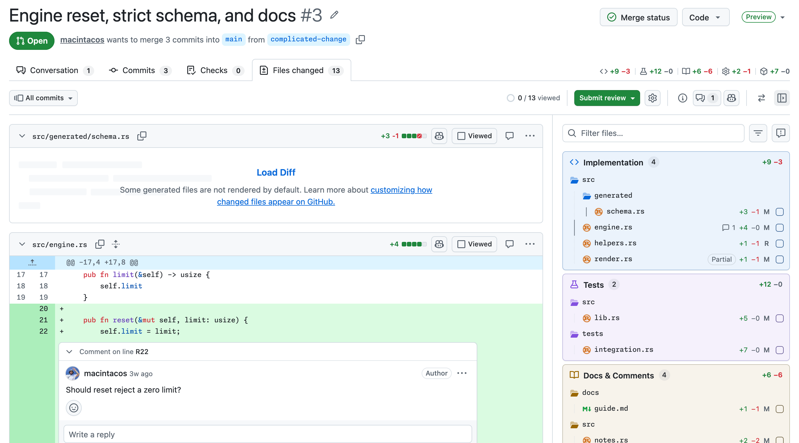
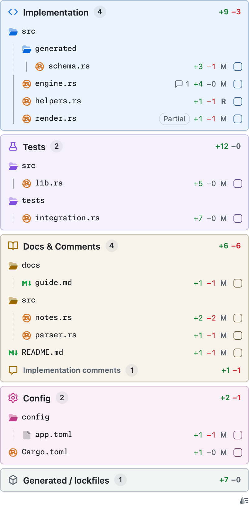
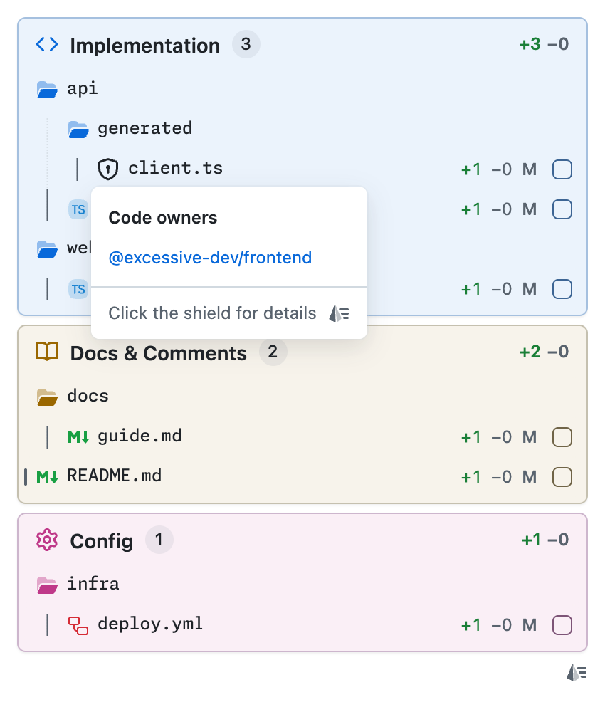
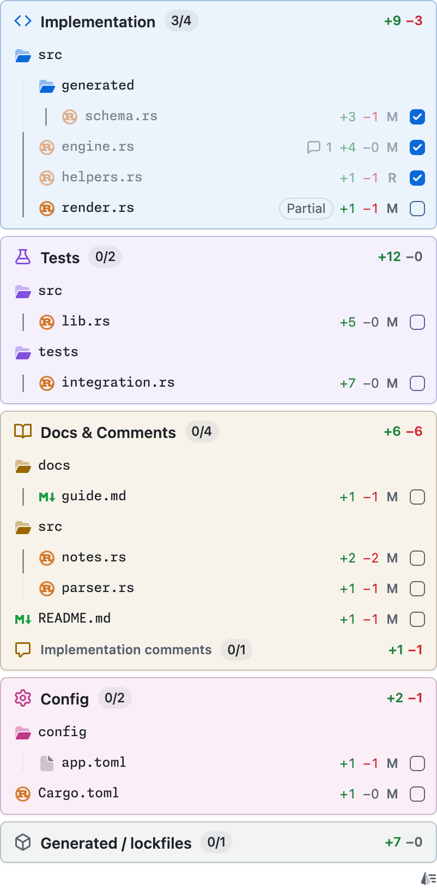
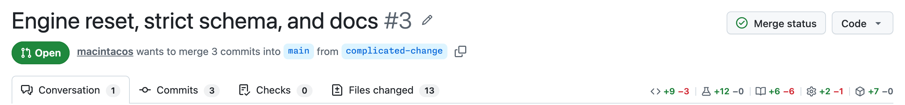
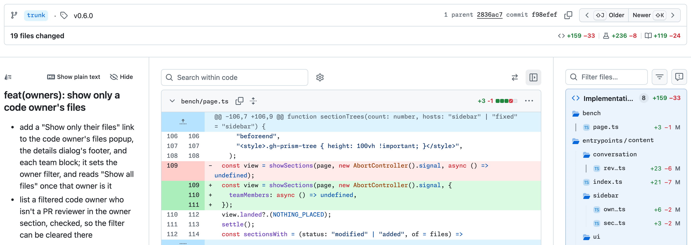

# gh-prism

gh-prism is a Chrome extension that sorts a GitHub pull request's changed files into
sections, so you can review one part at a time. It started by copying how other review
tools split a pull request's lines changed, and has grown from there: it now also works on
commit pages and on a pull request's Conversation tab.

AI-assisted pull requests often look large when only a small part of them is
implementation, and gh-prism lets you review that part first. See
[what it does](#what-it-does).

<picture>
  <source media="(prefers-color-scheme: dark)" srcset="docs/images/hero-dark.png">
  
</picture>

## What it does

gh-prism runs on commit pages and on a pull request's new Files changed tab
(`/pull/<number>/changes`), which GitHub offers as a feature preview; see
[Troubleshooting](#troubleshooting) to turn it on. Its code-owner shields also show on a
pull request's Conversation tab, and its lines-changed counts on the Conversation,
Commits, and Checks tabs.

### Sections in a sidebar

gh-prism replaces the file tree with a sidebar that sorts changed files into
Implementation, Tests, Docs & Comments, Config, and Generated / lockfiles.

- A file whose changes belong in more than one section is listed under each, marked
  `Partial`.
- Comment-only changes count toward Docs & Comments. An Implementation file's comment
  lines are listed under **Implementation comments**.
- The diffs follow the sidebar's order, and clicking a section's heading collapses it.

<details>
<summary>Screenshot: the sidebar's five sections, each with its file count and lines changed</summary>

<picture>
  <source media="(prefers-color-scheme: dark)" srcset="docs/images/sections-dark.png">
  
</picture>

</details>

### Code owners

On a pull request, a shield marks each file with code owners. Rest the pointer on it to
see who owns the file, or click it for details.

- On the Conversation tab, the shield beside a reviewer lists the changed files they own.
- **Only files owned by…** in the file tree's filter menu, or `gh-prism-owner=<owner>` in
  the Files changed URL, shows only one owner's files. The owner is a team such as
  `org/team`, or a user's login.
- GitHub shows you teams only in your own organizations, so a user's filter leaves out
  files they own through a team you can't see.

<details>
<summary>Screenshot: a file's code-owner shield and the owners it lists</summary>

<picture>
  <source media="(prefers-color-scheme: dark)" srcset="docs/images/code-owners-dark.png">
  
</picture>

</details>

### Viewed tracking

Files you've marked Viewed are dimmed in every section, and each section's heading counts
them (`N/M`).

- Tick a row's checkbox, or Alt-click the row (Option-click on macOS), to mark the file
  Viewed. Do either again to unmark it.
- It stays in step with GitHub's own Viewed toggle.

<details>
<summary>Screenshot: three files marked Viewed and each section's count</summary>

<picture>
  <source media="(prefers-color-scheme: dark)" srcset="docs/images/viewed-dark.png">
  
</picture>

</details>

### Lines changed by section

The lines-changed count in the header splits into one count per section.

- It shows on Files changed and commit pages, and on a pull request's Conversation,
  Commits, and Checks tabs.
- Click the counts to switch to GitHub's total and back. gh-prism remembers your choice.

<details>
<summary>Screenshot: a pull request's tab row with one count per section</summary>

<picture>
  <source media="(prefers-color-scheme: dark)" srcset="docs/images/lines-changed-dark.png">
  
</picture>

</details>

### Commit pages

A commit's message renders as Markdown in a column beside its diffs, and Older and Newer
links step through its history.

- Drag the column's edge to resize it. **Show plain text** shows the message as GitHub
  does, and **Hide** hides it on that commit.
- Press <kbd>Shift</kbd>+<kbd>J</kbd> for Older and <kbd>Shift</kbd>+<kbd>K</kbd> for
  Newer, unless you're typing.

<details>
<summary>Screenshot: a commit's message rendered beside its diffs, with Older and Newer</summary>

<picture>
  <source media="(prefers-color-scheme: dark)" srcset="docs/images/commit-dark.png">
  
</picture>

</details>

## Install

[Install gh-prism from the Chrome Web Store](https://chromewebstore.google.com/detail/nbgincngpiakbeihobifpdahbhflplgh),
then reload any GitHub tabs that were already open.

### Build from source

You need Git, Bun (a JavaScript runtime and package manager), and Chrome.

1. Clone the repository, install its dependencies, and build it:

   ```bash
   git clone https://github.com/macintacos/gh-prism-extension.git
   cd gh-prism-extension
   bun install
   bun run build
   ```

   If Bun comes from mise, a tool version manager, and fails with an untrusted-config
   error, run `mise trust` in the clone, then rerun the command.
2. In Chrome, open `chrome://extensions` and turn on **Developer mode**.
3. Click **Load unpacked** and choose the clone's `.output/chrome-mv3` folder. The picker
   hides folders whose names start with a dot. Press Cmd+Shift+. on macOS, or Ctrl+H on
   Linux, to show them.
4. Reload any GitHub tabs that were already open.

To update, run `git pull`, `bun install`, and `bun run build` in the clone. Then click the
reload button on gh-prism's card in `chrome://extensions`, and reload your GitHub tabs.

## Permissions

gh-prism needs no token or setup, because it reads through your signed-in GitHub session.
It sees only what your account can see.

It asks Chrome for access to these hosts, and nothing else:

- `https://github.com/*`: it runs on pull request and commit pages. It reads a pull
  request's or commit's diff, file contents, code owners, and reviewers, and an owning
  team's members only when GitHub shows you that team among the reviewers. On a commit
  page, it asks GitHub's commit search which commit comes next. When search finds none, it
  reads the branches that hold the commit and the first branch's commits.
- `https://patch-diff.githubusercontent.com/*`: where GitHub redirects diff downloads.
- `https://raw.githubusercontent.com/*`: where GitHub redirects raw-file downloads.

It also uses Chrome's extension storage. When Chrome sync is on, it syncs these to your
other computers:

- Which side the sidebar is on.
- Whether the header shows lines changed by section or GitHub's total.
- Whether a commit's message shows as Markdown or plain text.

It keeps these on this computer only:

- The width of the commit message column.
- The commits you hid the message on, up to the 100 most recent.
- Whether you closed the dialog on GitHub's classic Files changed tab.
- Which version's release notes, shown in the sidebar after an update, you dismissed or
  first saw, and when.
- Which section it put each file in, for the diffs it read most recently.

## Troubleshooting

- **No sections appear.** Reload the page, because tabs open before gh-prism was installed
  or reloaded don't run it. Then check that the URL contains `/pull/<number>/changes` or
  `/commit/<sha>`.
- **The Files changed tab looks like plain GitHub, and its URL ends in `/files` or
  `/commits/<sha>`.** That is GitHub's classic page, where gh-prism only shows a dialog.
  To reopen the dialog, click **Why is gh-prism off?** in the toolbar above the files.
  Sign in to GitHub. If you are signed in, turn on the **New Files Changed Experience**
  preview: click your profile picture, click **Feature preview**, choose
  **New Files Changed Experience**, and click **Enable**. GitHub Docs covers this in
  [Exploring early access releases with feature preview](https://docs.github.com/en/get-started/using-github/exploring-early-access-releases-with-feature-preview).
- **gh-prism asks you to sign in while you're signed in.** Check that you're signed in to
  GitHub in the Chrome profile gh-prism is installed in, then reload. Chrome's "Block
  third-party cookies" setting is untested with gh-prism.
- **gh-prism put a file in the wrong section.** Click **Report a miscategorized file**,
  the report icon beside the file tree's filter button. It opens an issue on gh-prism's
  repository with your gh-prism version filled in, and, on a public repository, the diff's
  URL.

## Contributing

See [CONTRIBUTING.md](CONTRIBUTING.md) to set up a clone, and [docs/](docs/README.md) for
how gh-prism works.

## License

gh-prism is released under the [MIT License](LICENSE).
