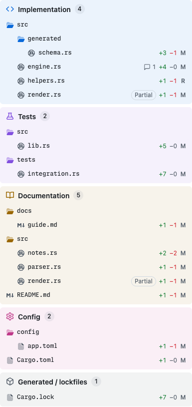

# gh-prism

On a pull request's Files changed tab and on a commit's page, gh-prism replaces GitHub's
file tree with a sidebar that groups changed files into sections, and orders the diffs to
match. You can review implementation, tests, docs, and config separately. It is for anyone
who reviews pull requests or commits on GitHub in Chrome.



## What it does

- gh-prism groups files by path into Implementation, Tests, Documentation, Config, and
  Generated / lockfiles.
- gh-prism moves a TypeScript, JavaScript, Rust, Go, Python, or Lua file whose changes are
  only comments or docstrings to Documentation.
- gh-prism moves a Rust, Python, or TypeScript file whose changes sit only inside inline
  test blocks to Tests. Examples of inline test blocks are a Rust `mod tests` block, a
  Python `def test_` function, and a TypeScript `describe` or `it` call.
- gh-prism lists a file whose hunks belong in different sections under each of those
  sections and marks each entry `Partial`. A hunk is one block of the diff: the changed
  lines plus a few unchanged lines around them. Clicking a `Partial` entry scrolls to the
  first of its hunks in that entry's section.
- gh-prism lays out the diffs in the order the sidebar lists their files: section by
  section, and in the sidebar's order within each section. A `Partial` file's diff sits
  where the sidebar first lists the file. gh-prism changes only the order on screen: Tab,
  screen readers, and Find in page (Ctrl+F or Cmd+F) still follow GitHub's order.
- On a commit with more than 40 files, and on a pull request large enough that GitHub
  loads its diffs as you scroll, the diffs keep GitHub's order. A notice above the
  sections says so.
- Clicking a file scrolls its diff smoothly into view. A long trip skips ahead to half a
  screen away first, so the scroll stays quick. On a commit's page, the scroll doesn't
  skip ahead, so a long trip takes longer. If your system is set to reduce motion, the
  click jumps straight to the diff instead.
- When gh-prism can read the diff, each row for a file that adds or removes lines shows
  how many, such as `+12 −3`. A `Partial` entry counts only its hunks in its own section,
  so it can show fewer lines than GitHub's total for the file. An image or other binary
  file shows `Binary` instead, because it has no lines to count.
- Each section's heading starts with the section's icon. When you point at a heading, the
  icon turns into an arrow. Click the heading to collapse or expand its files. A collapsed
  section still shows its file count.
- By default, the sidebar sits to the right of the diffs. While it does, GitHub's Collapse
  file tree button moves to the right end of the toolbar above the diffs, next to the
  sidebar.
- To move the sidebar to the left, click the two-arrows button beside the Collapse file
  tree button. Its tooltip reads `Move file tree to the left`. Click it again to move the
  sidebar back to the right. gh-prism remembers the side you pick, so pages you open or
  reload later use it. Tabs that are already open switch when you reload them.
- When you switch sides, or collapse or expand the file tree, the sidebar slides into
  place instead of jumping. If your system is set to reduce motion, it moves at once.
- In a window too narrow for the sidebar beside the diffs, GitHub opens the file tree as
  an overlay instead. gh-prism leaves that layout as GitHub has it and hides the
  two-arrows button.
- On a commit's page in a window narrower than about 1,000 pixels, the sidebar stays on
  the left, where GitHub puts its file tree. gh-prism hides the two-arrows button there.
- In the header of a pull request or commit, gh-prism splits GitHub's count of lines
  changed, such as `+1,604 −177`, into rounded labels called pills, one for each section
  that changed any lines. Each pill shows the section's icon and the lines that section
  adds and removes. Together, the pills add up to GitHub's total. Point at a pill to see
  the section's name and a short description of the changes gh-prism puts in it.
- The pills show by default. Click any pill to switch to GitHub's total. Point at the
  total to see each section's count. Click the total to switch back. gh-prism keeps the
  view you pick for every pull request or commit you open in that tab, until you reload
  the page.
- The header keeps GitHub's own count while gh-prism reads the diff. It also keeps that
  count when you view one commit or a range of commits in a pull request's Files changed
  tab, and when gh-prism can't read the diff.
- While gh-prism reads the diff, a progress bar replaces the sections, and a second
  progress bar covers the diffs. The sections and the diffs appear once gh-prism has
  placed every file in its sections. If reading takes longer than 15 seconds, the diffs
  appear in GitHub's order, then move into the sidebar's order once gh-prism finishes
  reading.
- gh-prism remembers where it placed each file for the 50 diffs it read most recently.
  When you reopen a pull request or commit whose diff hasn't changed, its sections and
  diffs appear without gh-prism reading each file again. A new push, or a new base branch,
  changes the diff, so gh-prism reads it again.
- When you view one commit or a range of commits instead of all commits in the Files
  changed view, gh-prism keeps grouping files by path only. It shows no line counts,
  `Binary` markers, or `Partial` entries. It also shows this notice:
  `Grouped by path. Docstring-only and inline-test changes are detected when viewing all commits.`
- gh-prism works on GitHub's new Files changed tab, at `/pull/<number>/changes`, and on a
  commit's page, at `/commit/<sha>`, where `<sha>` is the commit's hash. It leaves the
  classic Files changed tab untouched.
- On a commit's page, gh-prism reads the commit's diff. The sidebar shows line counts,
  `Binary` markers, and `Partial` entries, and finds docstring-only and inline-test
  changes, as it does for a whole pull request.

## Install

You need Git, Bun (a JavaScript runtime and package manager), and Chrome. Run steps 1 to 3
in a terminal.

1. Clone the repository and enter it:

   ```bash
   git clone https://github.com/macintacos/gh-prism-extension.git
   cd gh-prism-extension
   ```

2. Install the dependencies:

   ```bash
   bun install
   ```

3. Build the extension:

   ```bash
   bun run build
   ```

   The build writes the unpacked extension to `.output/chrome-mv3`.
4. In Chrome, open `chrome://extensions` and turn on **Developer mode**.
5. Click **Load unpacked** and choose the `.output/chrome-mv3` folder inside the clone.
   The picker hides folders whose names start with a dot. Press Cmd+Shift+. on macOS, or
   Ctrl+H on Linux, to show them.

To update gh-prism:

1. Run `git pull`.
2. Run `bun install`.
3. Run `bun run build`.
4. Click the reload button on the gh-prism card in `chrome://extensions`.
5. Reload any open GitHub tabs.

## Try it

1. Sign in to GitHub in the Chrome profile where you loaded gh-prism.
2. Open the Files changed tab of any pull request you can see, at a URL that contains
   `/pull/<number>/changes`. Reload any GitHub tab that was already open when you loaded
   gh-prism.

When it works, the sidebar shows the section headings.

No token or setup is needed, because gh-prism reads each pull request through your
signed-in browser session. It sees only the repositories your account can see. If it can't
read the diff, it still groups files by path. It also shows a short notice above the
sections saying why.

## Permissions

gh-prism needs access to three hosts and to Chrome's extension storage, and nothing else.

- `https://github.com/*` serves the pull request or commit page, its diff, and file
  contents. A content script, which is code that runs inside matching pages, also runs
  here, so gh-prism catches GitHub's in-page navigation into a pull request or commit. It
  acts only on Files changed and commit pages.
- `https://patch-diff.githubusercontent.com/*` is where GitHub redirects diff downloads.
- `https://raw.githubusercontent.com/*` is where GitHub redirects raw-file downloads.
- Extension storage holds the side you put the sidebar on, and where gh-prism placed each
  file for the 50 diffs it read most recently. Chrome syncs the side to your other
  computers when Chrome sync is on. The placements stay on this computer.

## Troubleshooting

- **No sections appear.** Reload the page. Tabs that were open before you loaded or
  reloaded gh-prism don't run it. Then check that the URL contains
  `/pull/<number>/changes` or `/commit/<sha>`.
- **A notice asks you to sign in while you are signed in.** Check that you are signed in
  to GitHub in the same Chrome profile where you loaded gh-prism, then reload the page.
  Chrome's "Block third-party cookies" setting is untested with gh-prism.
- **`bun` fails with a `mise` error about an untrusted config.** If Bun comes from mise, a
  tool version manager, run `mise trust` in the clone, then rerun the command that failed.

## Development

Contributors start with these commands:

- `mise install && mise run setup` installs the pinned tools and dependencies and
  registers the git hooks.
- `mise run dev` builds and opens gh-prism in its own Chrome profile at
  `~/.local/share/gh-prism-extension/chrome-profile`. Only one dev session can run at a
  time.
- `mise tasks` lists the rest.
- `scripts/create-sandbox.sh <owner>/<repo>` uses the `gh` CLI to create a private
  repository under an account you control, with three test pull requests.

## License

gh-prism is released under the [MIT License](LICENSE).
