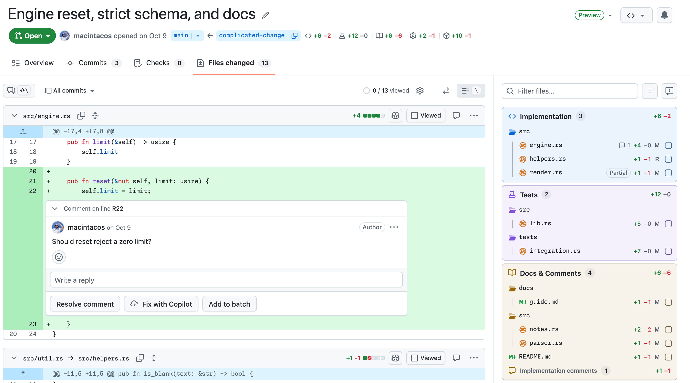
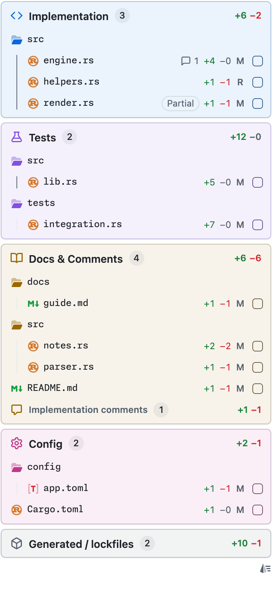
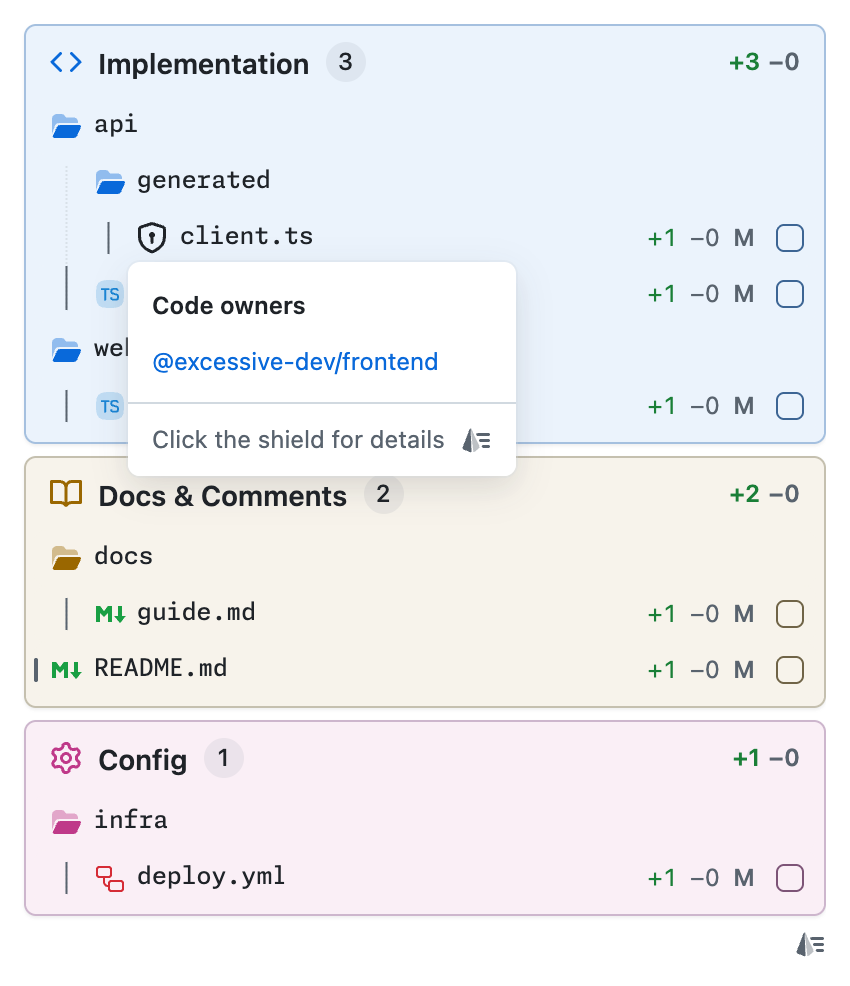
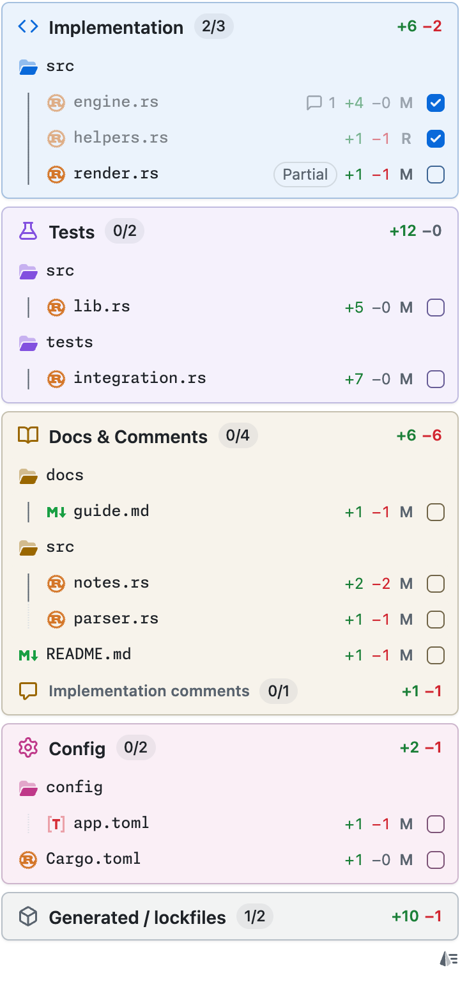
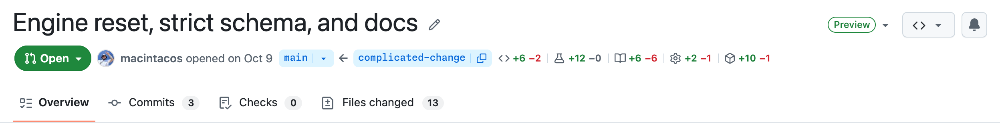
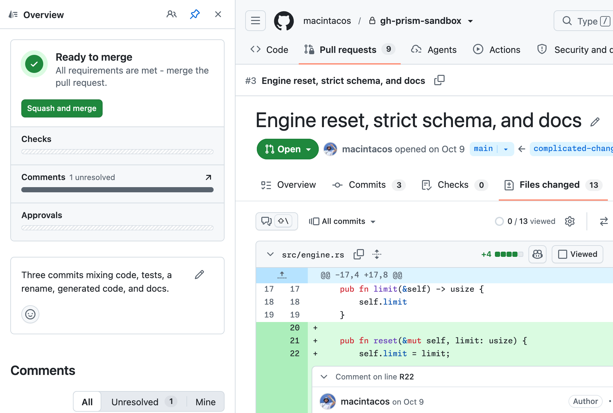
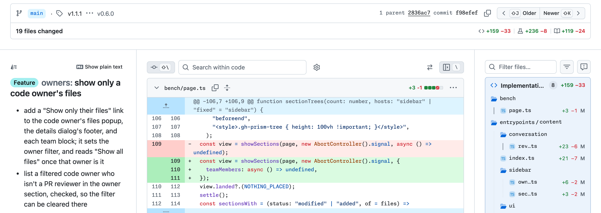
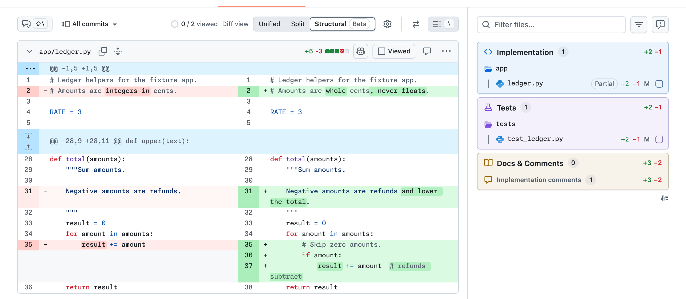

# gh-prism

gh-prism is a Chrome and Firefox extension that sorts a GitHub pull request's changed
files into sections, so you can review one part at a time. It started by copying how other
review tools split a pull request's lines changed, and has grown from there: it now also
works on commit pages and on a pull request's Conversation tab.

AI-assisted pull requests often look large when only a small part of them is
implementation, and gh-prism lets you review that part first. See
[what it does](#what-it-does).

Install it:

- Chrome:
  [Chrome Web Store](https://chromewebstore.google.com/detail/gh-prism-sectioned-pull-r/nbgincngpiakbeihobifpdahbhflplgh)
- Firefox: [Firefox Add-ons](https://addons.mozilla.org/en-US/firefox/addon/gh-prism/)

<picture>
  <source media="(prefers-color-scheme: dark)" srcset="docs/images/hero-dark.png">
  
</picture>

## What it does

gh-prism runs on commit pages and on a pull request's new Files changed tab
(`/pull/<number>/changes`), which GitHub offers as a feature preview; see
[Troubleshooting](#troubleshooting) to turn it on. Its code-owner shields also show on a
pull request's Conversation tab and beside review comment authors on Files changed, the
classic page included, and its lines-changed counts on the Conversation, Commits, and
Checks tabs.

### Sections in a sidebar

gh-prism replaces the file tree with a sidebar that sorts changed files into
Implementation, Tests, Docs & Comments, Config, and Generated / lockfiles.

- A file whose changes belong in more than one section is listed under each, marked
  `Partial`.
- Comment-only changes count toward Docs & Comments. An Implementation file's comment
  lines are listed under **Implementation comments**.
- The diffs follow the sidebar's order, except on very large pull requests, and clicking a
  section's heading collapses it.

<details>
<summary>Screenshot: the sidebar's five sections, each with its file count and lines changed</summary>

<picture>
  <source media="(prefers-color-scheme: dark)" srcset="docs/images/sections-dark.png">
  
</picture>

</details>

### Code owners

On a pull request, a file with code owners shows a shield when you hover or focus its row.
Rest the pointer on the shield to see who owns the file, or click it for details. The
shield button right after the Conversation button in the Files changed toolbar lists every
changed file by its code owners, and marks the files no current reviewer owns.

- On the Conversation tab, the shield beside a team or person in the Reviewers list lists
  the changed files they own. The shield button at the right end of the Reviewers heading
  lists every changed file by its code owners, as the toolbar button does.
- On the Conversation and Files changed tabs, the shield also shows beside a comment
  author who owns changed files, PR reviewer or not.
- **Only files owned by…** in the file tree's filter menu, or `gh-prism-owner=<owner>` in
  the Files changed URL, shows only one owner's files. The owner is a team such as
  `org/team`, or a user's login.
- GitHub shows you teams only in your own organizations, so a user's filter leaves out
  files they own through a team you can't see.

<details>
<summary>Screenshot: a file's code-owner shield and the owners it lists</summary>

<picture>
  <source media="(prefers-color-scheme: dark)" srcset="docs/images/code-owners-dark.png">
  
</picture>

</details>

### Viewed tracking

Files you've marked Viewed are dimmed in every section, and each section's heading counts
them (`N/M`).

- Tick a row's checkbox, or Alt-click the row (Option-click on macOS), to mark the file
  Viewed. Do either again to unmark it.
- It stays in step with GitHub's own Viewed toggle.

<details>
<summary>Screenshot: three files marked Viewed and each section's count</summary>

<picture>
  <source media="(prefers-color-scheme: dark)" srcset="docs/images/viewed-dark.png">
  
</picture>

</details>

### Lines changed by section

The lines-changed count in the header splits into one count per section.

- It shows on Files changed and commit pages, and on a pull request's Conversation,
  Commits, and Checks tabs.
- Click the counts to switch to GitHub's total and back. gh-prism remembers your choice.

<details>
<summary>Screenshot: a pull request's header with one count per section</summary>

<picture>
  <source media="(prefers-color-scheme: dark)" srcset="docs/images/lines-changed-dark.png">
  
</picture>

</details>

### Conversation panel

On Files changed, the Conversation button at the left end of the toolbar, or
<kbd>Shift</kbd>+<kbd>&#92;</kbd>, opens the pull request's Conversation tab in a panel on
the left, so you can read and reply to it without leaving the diffs.

- Pin the panel to keep it open as a column beside the diffs, and drag its edge to resize
  it. Unpinned, it covers the page, and a click outside it or <kbd>Esc</kbd> closes it.
- Buttons in its header jump to the pull request's checks, and to its reviewers, labels,
  and projects.

<details>
<summary>Screenshot: the Overview tab pinned beside a pull request's diffs</summary>

<picture>
  <source media="(prefers-color-scheme: dark)" srcset="docs/images/conversation-dark.png">
  
</picture>

</details>

### Commit pages

A commit message longer than its subject line renders as Markdown in a column beside its
diffs, and Older and Newer links step through its history.

- Drag the column's edge to resize it. **Show plain text** shows the message as GitHub
  does.
- The button at the left end of the toolbar above the diffs, a commit icon beside a
  <kbd>⇧&#92;</kbd> keycap, hides the message on every commit and shows it again. So does
  <kbd>Shift</kbd>+<kbd>&#92;</kbd>, unless you're typing.
- Press <kbd>Shift</kbd>+<kbd>J</kbd> for Older and <kbd>Shift</kbd>+<kbd>K</kbd> for
  Newer, unless you're typing.

<details>
<summary>Screenshot: a commit's message beside its diffs, its title led by a Feature label</summary>

<picture>
  <source media="(prefers-color-scheme: dark)" srcset="docs/images/commit-dark.png">
  
</picture>

</details>

### Structural diffs (Beta)

A control beside GitHub's diff settings gear, on a pull request's Files changed tab and on
a commit's page, picks how the diffs are drawn: **Unified**, **Split**, or **Structural**.

- Structural draws GitHub's Split layout and highlights the code that changed. A line
  changed in full shows only GitHub's line colour, with no highlight, and lines whose
  change only reformats them take a lighter tint. In a comment, a string, or a `.txt`
  file, it highlights the words that changed.
- It keeps GitHub's pairing of old and new lines, and doesn't mark code that moved.
- It works on Bash, C, C++, C#, CSS, Go, HTML, Java, JavaScript, JSON, Kotlin, Lua,
  Markdown, PHP, Python, Ruby, Rust, Swift, TOML, TSX, TypeScript, YAML, and `.txt` files,
  and leaves every other file as GitHub draws it. A file in a language it doesn't cover
  says so above its diff, with a **Request this language** link. The link opens a
  new-issue form on gh-prism's repository with the file's extension filled in, and nothing
  else about the file.
- While the control shows, GitHub's diff settings menu leaves out its own Layout choice,
  which the control replaces. On a window too narrow for the control, the menu offers
  Layout as before.
- gh-prism remembers the choice. Choosing Unified or Split turns Structural off, and so
  does choosing Unified from GitHub's own Layout menu. On a pull request filtered to one
  commit, Structural is unavailable. Structural is in beta, so it may have bugs.

<details>
<summary>Screenshot: a Python file in Structural, with only the changed words highlighted</summary>

<picture>
  <source media="(prefers-color-scheme: dark)" srcset="docs/images/structural-dark.png">
  
</picture>

</details>

## Install

Install gh-prism from the
[Chrome Web Store](https://chromewebstore.google.com/detail/gh-prism-sectioned-pull-r/nbgincngpiakbeihobifpdahbhflplgh)
or [Firefox Add-ons](https://addons.mozilla.org/en-US/firefox/addon/gh-prism/), then
reload any GitHub tabs that were already open.

### Build from source

You need Git, Bun (a JavaScript runtime and package manager), and Chrome or Firefox. The
build uses Bun 1.4.2 and Node 24.21.0, the versions pinned in `mise.lock`.

1. Clone the repository, install its dependencies, and build it:

   ```bash
   git clone https://github.com/macintacos/gh-prism-extension.git
   cd gh-prism-extension
   bun install
   bun run build
   ```

   If Bun comes from mise, a tool version manager, and fails with an untrusted-config
   error, run `mise trust` in the clone, then rerun the command.
2. Load the build into your browser:
   - **Chrome:** open `chrome://extensions` and turn on **Developer mode**. Click
     **Load unpacked** and choose the clone's `.output/chrome-mv3` folder. The picker
     hides folders whose names start with a dot. Press
     <kbd>Cmd</kbd>+<kbd>Shift</kbd>+<kbd>.</kbd> on macOS, or
     <kbd>Ctrl</kbd>+<kbd>H</kbd> on Linux, to show them.
   - **Firefox:** open `about:debugging#/runtime/this-firefox`, click
     **Load Temporary Add-on…**, and choose the clone's
     `.output/firefox-mv3/manifest.json`. Firefox removes a temporary add-on when it
     quits, so load it again after a restart. If Firefox lists gh-prism without access to
     github.com, turn it on in `about:addons` → gh-prism → **Permissions**.
3. Reload any GitHub tabs that were already open.

To update, run `git pull`, `bun install`, and `bun run build` in the clone. Then click the
reload button on gh-prism's card in `chrome://extensions`, or **Reload** on gh-prism's
entry in `about:debugging`, and reload your GitHub tabs.

To rebuild a release from its sources zip, unzip it, then run
`bun install --frozen-lockfile` and `bun run build`. The Firefox build is
`.output/firefox-mv3`. A release build also sets `WXT_RELEASE_NOTES` to that version's
GitHub Release notes, which only fill the sidebar's What's new in
`content-scripts/content.js`. To match a release byte for byte, build with
`WXT_RELEASE_NOTES` set to that version's GitHub Release notes. The rebuild also
reproduces the structural engine's WebAssembly, the `.wasm` files under
`.output/firefox-mv3/structural/`. Each is copied unmodified from the npm package
`bun.lock` pins: `web-tree-sitter` and one grammar package per language. No npm package
carries the Markdown and Swift grammars, so `bun install` downloads those two from their
projects' GitHub releases into `.grammars/` and refuses a file whose SHA-256 differs from
the one [`utils/structural/packaged.ts`](utils/structural/packaged.ts) pins. No binary is
committed.

Upgrading the engine or adding a grammar:

1. Upgrade `web-tree-sitter` and the grammar packages together, to exact versions, because
   a grammar's ABI must be one the runtime loads. For a downloaded grammar, change its
   version, URL, and SHA-256 in `FETCHED_WASM`. The engine suite parses with every
   grammar, so `mise run test structural` fails on a mismatch.
2. For a new grammar, add its extensions to
   [`utils/structural/grammar.ts`](utils/structural/grammar.ts), its file to
   `utils/structural/packaged.ts`, and a row for it in
   [`tests/utils/structural/languages.test.ts`](tests/utils/structural/languages.test.ts).
3. Regenerate or drop `patches/web-tree-sitter@<version>.patch`, per
   [docs/DEVELOPMENT.md](docs/DEVELOPMENT.md) § Patched dependencies.
4. Update [`public/third-party-notices.txt`](public/third-party-notices.txt).
5. Run `mise run lint-firefox` and expect no warnings.
6. Build the Firefox sources zip and run the sources check: `bunx wxt zip -b firefox`,
   then `bun scripts/tasks/cli.ts check-sources`. It rebuilds from the zip and fails on
   any difference, the `.wasm` files included.

## Permissions

gh-prism needs no token or setup, because it reads through your signed-in GitHub session.
It sees only what your account can see.

It asks your browser for access to only these hosts:

- `https://github.com/*`: it runs on every GitHub page, so it catches GitHub's in-page
  navigation, and acts only on pull request and commit pages. It reads a pull request's or
  commit's diff and file contents, and a pull request's code owners and reviewers. It
  reads each owning team's members, to tell who owns files through a team. On a commit
  page, it asks GitHub's commit search which commit comes next. When search finds none, it
  reads the branches that hold the commit and the first branch's commits.
- `https://patch-diff.githubusercontent.com/*`: where GitHub redirects diff downloads.
- `https://raw.githubusercontent.com/*`: where GitHub redirects raw-file downloads.

It also lets the Conversation panel show a pull request's Conversation tab in Files
changed. GitHub refuses to be shown inside another page, so gh-prism lifts that refusal
only for the panel's frame in that tab, and keeps the rest of GitHub's security policy.

It also uses the browser's extension storage. When Chrome sync or Firefox Sync is on, it
syncs these to your other computers:

- Which side the sidebar is on.
- Whether the header shows lines changed by section or GitHub's total.
- Whether a commit's message shows as Markdown or plain text.
- Whether the Conversation panel is pinned, and whether it's open.
- Whether you hid the commit message.
- Whether Structural mode is on.

It keeps these on this computer only:

- The width of the commit message column.
- The width of the pinned Conversation panel.
- Whether you closed the dialog on GitHub's classic Files changed tab.
- Which version's release notes, shown in the sidebar after an update, you dismissed or
  first saw, and when.
- Which section it put each file in, for the diffs it read most recently.

## Troubleshooting

- **No sections appear.** Reload the page, because tabs open before gh-prism was installed
  or reloaded don't run it. Then check that the URL contains `/pull/<number>/changes` or
  `/commit/<sha>`.
- **The Files changed tab looks like plain GitHub, and its URL ends in `/files` or
  `/commits/<sha>`.** That is GitHub's classic page, where gh-prism only shows a dialog
  and the shields beside review comments. To reopen the dialog, click
  **Why is gh-prism off?** in the toolbar above the files. Sign in to GitHub. If you are
  signed in, turn on the **New Files Changed Experience** preview: click your profile
  picture, click **Feature preview**, choose **New Files Changed Experience**, and click
  **Enable**. GitHub Docs covers this in
  [Exploring early access releases with feature preview](https://docs.github.com/en/get-started/using-github/exploring-early-access-releases-with-feature-preview).
- **gh-prism asks you to sign in while you're signed in.** Check that you're signed in to
  GitHub in the Chrome profile gh-prism is installed in, then reload. Chrome's "Block
  third-party cookies" setting is untested with gh-prism.
- **Firefox groups files by path and asks you to sign in.** gh-prism reads GitHub with the
  sign-in cookie Firefox sends to github.com. When Firefox withholds it, as in a container
  tab not signed in to GitHub or under strict Enhanced Tracking Protection, gh-prism
  groups files by path instead of sorting them into sections. Sign in to GitHub in that
  container, or turn off Enhanced Tracking Protection for github.com from the shield in
  the address bar, then reload.
- **gh-prism put a file in the wrong section.** Click **Report a miscategorized file**,
  the report icon beside the file tree's filter button. It opens a new-issue form on
  gh-prism's repository with your gh-prism version filled in, and, on a public repository
  only, the diff's URL.

## Contributing

See [CONTRIBUTING.md](CONTRIBUTING.md) to set up a clone, and [docs/](docs/README.md) for
how gh-prism works.

## License

gh-prism is released under the [MIT License](LICENSE). The extension bundles third-party
software for structural diffing under its own licences, listed in
[`public/third-party-notices.txt`](public/third-party-notices.txt), which ships in the
extension.
