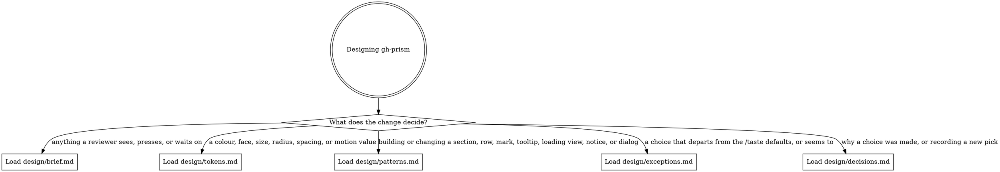

# gh-prism design

*Audience: coding agents changing how gh-prism looks, moves, or reads, and the people who
maintain its design direction.*

`design/` holds gh-prism's design direction: how its UI looks, moves, and words things
inside GitHub's pages. That UI is the sidebar, the header counter (the per-section
breakout of the lines-changed count, on a commit's page and a pull request's tabs), the
commit message rendered as Markdown on a commit's page (in a column beside the diffs on a
wide window), the dialog gh-prism opens on GitHub's classic Files changed page, the code
owner details dialog that a code-owner shield opens, and the Conversation panel that shows
a pull request's Conversation tab beside Files changed. [`CONTEXT.md`](../CONTEXT.md)
defines the domain terms these files use, such as section, Viewed, and what's new.
[`docs/agents/styling-rules.md`](../docs/agents/styling-rules.md) says how a stylesheet is
written, imported, and scoped.

## Routing

Read the digraph as a checklist, not a single path. Load every file whose edge matches
your change before you design or style that part.

## Updating design/

Follow these rules whether or not you use `/taste`, the maintainer's Claude Code design
skill, whose `init`, `mockup`, and `review` commands read and write these files:

- **Put a new value in its source first, then point `tokens.md` at it.** `tokens.md` holds
  pointers, so a value copied there drifts from the code. A value the code doesn't have
  yet, such as the motion scale, lives in `tokens.md` until it lands.
- **Add a pattern to `patterns.md` once a second element uses it.** One element is a
  detail of its module. Two make a pattern the next element should copy.
- **Record a departure from the `/taste` defaults in `exceptions.md`, with the default it
  replaces and why.** Without the entry, `/taste review` reports the departure as a miss.
- **Record a design pick in `decisions.md`, dated, newest first.** A pick is any choice
  between compared options, from `/taste mockup`, a review, or a change.
- **Give a new file in `design/` an edge in this digraph, and update the `design/` entry
  in [`docs/agents/documentation-rules.md`](../docs/agents/documentation-rules.md).**
