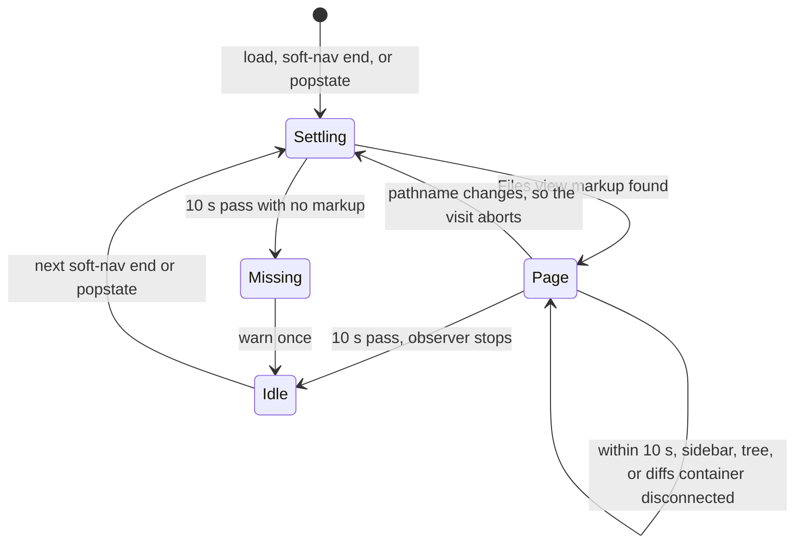
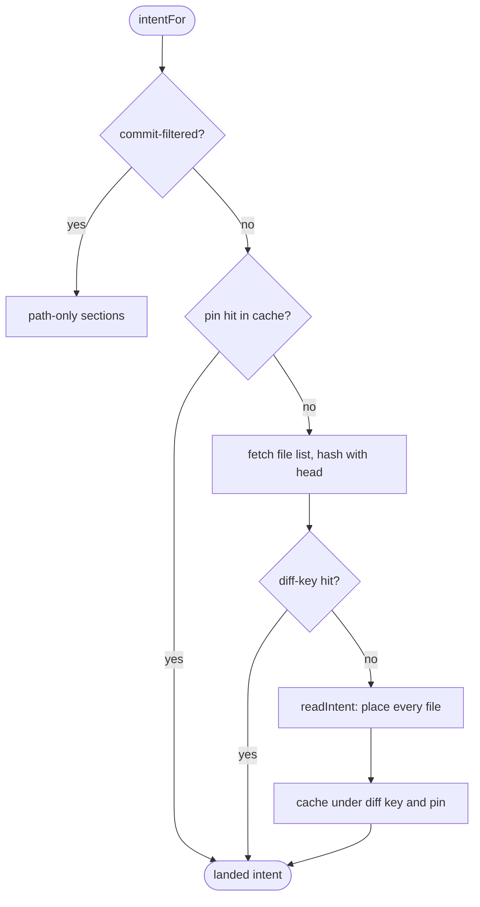

# Architecture

*Audience: contributors and coding agents learning how gh-prism works before they change
it.*

gh-prism is a Chrome extension built with WXT, a framework for browser extensions. It has
two parts: a service worker that fetches pull request data, and a content script that
reshapes GitHub's Files view. Each section below names the module behind its claims, so
you can read the code next. Terms such as visit, page, intent, and landing are defined in
[`CONTEXT.md`](../CONTEXT.md).

## Overview

The service worker in [`entrypoints/background.ts`](../entrypoints/background.ts) reads
diffs and file contents from github.com. It serves them to content scripts over a
long-lived message port, defined in
[`utils/github/pr-port.ts`](../utils/github/pr-port.ts). It also clears the intent cache
whenever the extension is installed, updated, or reloaded in development.

The content script in [`entrypoints/content/index.ts`](../entrypoints/content/index.ts)
runs on every github.com page at `document_start`, so its watcher is in place before
GitHub first renders the page. It cannot match only Files view URLs, because of GitHub's
soft navigation: GitHub swaps in a new page without loading a new document, so a script
matched to pull request URLs would never be injected when you click through to one.
Instead, it watches every page for a Files view to appear.

## Page kinds

[`entrypoints/content/files-page.ts`](../entrypoints/content/files-page.ts) is the one
script module that holds selectors into GitHub's Files view markup. Each kind of Files
view is a `PageKind`: a pull request's Files changed tab (`prPage`) and a commit's page
(`commitPage`). A `PageKind` lists where that page keeps its sidebar, native tree, diff
list, and diffstat, and how a row's link reveals its diff.

`findFilesPage` tries each entry of `PAGE_KINDS` in turn and returns the first whose
sidebar, native tree, and diffs are all present. Callers then ask `files-page.ts`'s
helpers rather than branching on the kind, so a new page kind is a new `PAGE_KINDS` entry.

[`utils/github/files-route.ts`](../utils/github/files-route.ts) reads the URL side: which
diff a pathname names, and whether a pull request's view is commit-filtered.

## The visit lifecycle

[`entrypoints/content/visit/watch.ts`](../entrypoints/content/visit/watch.ts) follows
visits across GitHub's navigation. A visit is one stay on a Files view's pathname, and a
page is one render of its markup. GitHub may replace the markup several times in one
visit, so `watchFilesPages` reports each replacement as a new page.

The watcher wakes on first load, on GitHub's `soft-nav:end` event, and on `popstate`. Each
wake starts a 10-second settle window. During that window a mutation observer checks
whether the page is still connected. Once the sidebar, native tree, or diffs container
(the diff list's parent) is disconnected, the watcher aborts that page and hands over the
replacement as a new page. A list swap inside the container is not a new page; `order.ts`
follows it. A pathname change aborts the whole visit. A hash change, which every file
click makes, is not a new visit. When the window ends on a Files view path with no markup
found, the watcher warns once and leaves GitHub's tree alone; the next wake still starts a
new settle window.



[`entrypoints/content/visit/land.ts`](../entrypoints/content/visit/land.ts) runs on each
page. `showVisit` mounts five views (the sidebar sections, the diff order, the diffstat,
and the on-screen and Viewed trackers that feed the sidebar). Then `land` passes the
intent read's steps to the views: pending while the read runs, progress as files are
placed, landed with the result, and then each file's section. Every view gets a step
before any view gets the next. `land` owns the only observer of the native tree, and it
re-lists the sections after each change to the tree. One visit reads intent once:
`index.ts` wraps the read in `shareIntent`, so every page of the visit joins the same
read.

## Intent and its cache

gh-prism lists each changed file in one of five sections, such as Implementation or Tests.
A file's path picks its section, unless a hunk rule claims some of its changed blocks for
Documentation or Tests by what they change. Intent is where the hunk rules place a diff's
files. `intentFor` in [`utils/intent/read.ts`](../utils/intent/read.ts) finds it in three
steps, cheapest first:

1. **Pin hit.** The diff pin, the base and head commits that the page's embedded data
   names, keys a cache entry. A hit returns without connecting to the service worker.
2. **Diff-key hit.** Otherwise it fetches the diff's file list and hashes it with the head
   commit. A hit returns the cached intent and also stores it under the pin.
3. **Read.** Otherwise `readIntent` places every file, reading each file's head where a
   hunk rule needs it, at most six at once. It caches the result under both keys, unless a
   rate limit or failure cut a file's read short.

A commit-filtered view skips all three and keeps path-only sections.



[`utils/intent/cache.ts`](../utils/intent/cache.ts) keeps intent in extension storage.
`index.ts` sizes it to 50 entries; a pinned diff takes two, one under its diff key and one
under its pin. Each store moves its key to the front of an index and drops the entries
past the limit, so the cache keeps the 50 most recently stored keys. A cache hit alone
does not refresh its entry. The service worker clears the cache on install, update, and
dev reload, because a new build may place files differently.

## Section rows

[`entrypoints/content/sidebar/sections-view.ts`](../entrypoints/content/sidebar/sections-view.ts)
draws the sidebar's sections. GitHub's native tree stays mounted and hidden as the source
of truth, and each render re-reads its rows. A click on a section's row clicks the native
row's link. That link's handler mounts a diff that GitHub has virtualized away, which a
bare hash jump would not do.

[`entrypoints/content/sidebar/section-tree.ts`](../entrypoints/content/sidebar/section-tree.ts)
renders each section as its own `@pierre/trees` file tree in a shadow root. A tree's
height follows its visible rows, so the whole sidebar scrolls as one. The sections view
calls each tree's `sync()` when the sidebar scrolls or resizes, and `sync()` renders only
the rows near the viewport. A tree far out of view renders none.

[`entrypoints/content/diffs/on-screen.ts`](../entrypoints/content/diffs/on-screen.ts)
tracks which files' diffs are on screen. It observes the mounted diff regions with one
`IntersectionObserver`, its top inset by `coveredTop` (the band GitHub's sticky chrome
covers), and feeds each changed set of paths to the sections view's `onScreen`. Each tree
marks those rows faintly, and a collapsed section marks its header instead. The mark never
scrolls the sidebar.

[`entrypoints/content/diffs/viewed.ts`](../entrypoints/content/diffs/viewed.ts) tracks
which files the reviewer has marked Viewed. On the visit a full load started (before
GitHub's first navigation), `index.ts` seeds it from GitHub's route data
(`readViewedSeed`) when that data names the visit's pull request. It then reads each
header's toggle as diffs mount and as GitHub flips them (`observeViewed`), and keeps each
file's last-read state for the rest of the visit, so a file whose diff unmounts stays as
read. It feeds the viewed paths to the sections view's `viewed`, which dims their rows
and, once any file is Viewed, counts each section's viewed files in its header. It also
gives each file row a checkbox, which the `@pierre/trees` patch renders beside the row.
Ticking one calls `markViewed`, which clicks the file's header toggle, revealing the diff
first through `revealUntil` when that toggle isn't mounted. Nothing dims, counts, or shows
a checkbox unless the page offers Viewed.

## Diff order and reveal

[`entrypoints/content/diffs/order.ts`](../entrypoints/content/diffs/order.ts) lays
GitHub's diffs out in the order the sidebar lists their files. It sets CSS `order` on each
diff's entry and moves no node that React renders, so comments, Viewed, and GitHub's own
scroll to a file keep working. While GitHub virtualizes a long diff list, placing each
diff absolutely, the diffs keep GitHub's order, so they no longer follow the sidebar.

[`entrypoints/content/diffs/reveal.ts`](../entrypoints/content/diffs/reveal.ts) brings a
file's diff, or a line in it, into view. On a pull request it clicks the native row's link
and glides the window to where GitHub scrolls. On a commit it follows the link's hash
instead, since a click there would let GitHub's router undo the scroll.

## Styling

New UI uses Tailwind CSS v4 utilities with a `tw:` prefix. Colors, radii, and type come
from GitHub's Primer design tokens through
[`entrypoints/content/ui/tailwind.css`](../entrypoints/content/ui/tailwind.css), so themes
follow GitHub. Each feature's sheet sits beside its module and is imported with `?inline`,
then mounted only on the pages that need it. The rules for writing styles are in
[`docs/agents/styling-rules.md`](agents/styling-rules.md).

## Source layout

```text
entrypoints/
  background.ts          service worker: PR data port, cache clearing on install
  content/
    index.ts             content script entry: wires the watcher, intent, and views
    files-page.ts        every GitHub Files view selector; page kinds
    visit/               visit and page lifecycle; landing intent on views
    sidebar/             section trees, sidebar side switch
    diffs/               diff order, reveal, on-screen and Viewed tracking
    header/              diffstat breakout
    ui/                  shared DOM helpers, loading view, Tailwind tokens
utils/
  github/                routes, diff parsing, the PR data port and source
  intent/                reading, caching, and landing intent
  hunk-rules/            the docstring and inline-test rules
  sections.ts            path rules for the five sections
  prefs.ts               saved preferences
tests/                   Vitest unit tests, mirroring the source tree
e2e/                     Playwright smoke tests against the built extension
bench/                   large-diff benchmark
```
