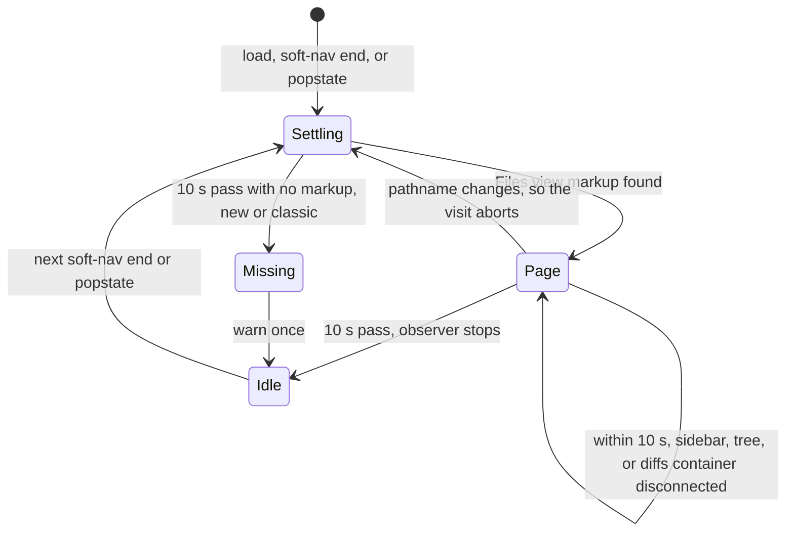

# Architecture

*Audience: contributors and coding agents learning how gh-prism works before they change
it.*

gh-prism is a Chrome extension built with WXT, a framework for browser extensions. It has
two parts: a service worker that fetches pull request data, and a content script that
reshapes GitHub's Files view and reads a pull request's code owners and reviewers itself.
Each section below names the module behind its claims, so you can read the code next.
Terms such as visit, page, intent, and landing are defined in
[`CONTEXT.md`](../CONTEXT.md).

## Overview

The service worker in [`entrypoints/background.ts`](../entrypoints/background.ts) reads
diffs and file contents from github.com. It serves them to content scripts over a
long-lived message port, defined in
[`utils/github/pr-port.ts`](../utils/github/pr-port.ts). It also clears the intent cache
whenever the extension is installed, updated, or reloaded in development, and on a fresh
install it marks the installed version's what's-new notes dismissed.

The content script in [`entrypoints/content/index.ts`](../entrypoints/content/index.ts)
runs on every github.com page at `document_start`, so its watcher is in place before
GitHub first renders the page. It cannot match only Files view URLs, because of GitHub's
soft navigation: GitHub swaps in a new page without loading a new document, so a script
matched to pull request URLs would never be injected when you click through to one.
Instead, it watches every page for a Files view to appear, for a pull request's header
tabs, where it shows the diffstat and, on Conversation, a code owner's files, and for a
pull request's classic page, where it opens a dialog instead.

## Page kinds

[`entrypoints/content/files-page.ts`](../entrypoints/content/files-page.ts) is the one
script module that holds selectors into GitHub's Files view markup. Each kind of Files
view is a `PageKind`: a pull request's Files changed tab (`prPage`) and a commit's page
(`commitPage`). A `PageKind` lists where that page keeps its sidebar, native tree, diff
list, and diffstat, and how a row's link reveals its diff. A pull request's kind also
names the narrow layout's overlay copy of the sidebar, and a commit's kind names its
message box.

`findFilesPage` tries each entry of `PAGE_KINDS` in turn and returns the first whose
sidebar, native tree, and diffs are all present, passing over the overlay's copy. Callers
then ask `files-page.ts`'s helpers rather than branching on the kind, so a new page kind
is a new `PAGE_KINDS` entry.

[`utils/github/files-route.ts`](../utils/github/files-route.ts) reads the URL side: which
diff a pathname names, and whether a pull request's view is commit-filtered. It reads the
classic page's `/files` and `/commits/<sha>` too, which GitHub redirects to `/changes` and
`/changes/<sha>` wherever it shows the new page.

`findClassicPage` finds a pull request's classic page instead: GitHub's toolbar above the
diffs and the toolbar's review tools. `isSignedIn` reads whether GitHub served the page to
a signed-in viewer.

`readHeaderTabPr` reads which pull request a header tab (Conversation, Commits, or Checks)
belongs to, and `findHeaderPage` finds that tab's diffstat slot in the header.

## The visit lifecycle

[`entrypoints/content/visit/watch.ts`](../entrypoints/content/visit/watch.ts) follows
visits across GitHub's navigation. A visit is one stay on a Files view's pathname, or on
one pull request's header tabs, and a page is one render of its markup. GitHub may replace
the markup several times in one visit, so `watchFilesPages` reports each replacement as a
new page.

The watcher wakes on first load, on GitHub's `soft-nav:end` event, and on `popstate`. Each
wake starts a 10-second settle window. During that window a mutation observer checks
whether the page is still connected. Once the sidebar, native tree, or diffs container
(the diff list's parent) is disconnected, the watcher aborts that page and hands over the
replacement as a new page. A list swap inside the container is not a new page; `order.ts`
follows it. A pathname change aborts the whole visit. A hash change, which every file
click makes, is not a new visit. When the window ends on a Files view path with no markup
found, not even the classic page's, the watcher warns once and leaves GitHub's tree alone;
the next wake still starts a new settle window. `watchClassicPages` follows the classic
page the same way, through the same settle windows, and never warns. So does
`watchHeaderPages`, for a pull request's header tabs: its page is the header's counter
slot, and moving between one pull request's header tabs keeps the visit, so the mounted
counter stays without a new read. Leaving for Files changed, another pull request, or
anywhere else ends it.



[`entrypoints/content/visit/land.ts`](../entrypoints/content/visit/land.ts) runs on each
page. `showVisit` mounts six views (the sidebar sections, the diff order, the j/k file
keys, the diffstat, and the on-screen and Viewed trackers that feed the sidebar). Then
`land` passes the intent read's steps to the views: pending while the read runs, and with
an owner filter until the code owners land too; progress as files are placed, landed with
the result, and then each file's section. Every view gets a step before any view gets the
next. `land` owns the only observer of the native tree, and it re-lists the sections after
each change to the tree. While a pull request's narrow layout has its "Files" overlay
open, `land` also observes the overlay's copy of the tree and lists from it, telling each
view through `shownIn` before it re-lists. One visit reads intent once: `index.ts` wraps
the read in `shareIntent`, so every page of the visit joins the same read. A header tab's
visit reads intent the same way, and `showHeaderTab` mounts only the diffstat on each of
its pages once the read lands, skipping a page dropped before then.

## The classic page notice

[`entrypoints/content/classic/notice.ts`](../entrypoints/content/classic/notice.ts) runs
on each classic page. `showClassicNotice` opens a native modal `<dialog>` that says why
gh-prism isn't running there and how to get the new page: signed out, sign in; signed in,
turn on GitHub's New Files Changed Experience preview. Closing it any way, by its buttons,
Esc, or a click outside it, dismisses it. A **Why is gh-prism off?** button beside the
toolbar's review tools opens it again. `index.ts` reads the dismissal from
`classicNoticeDismissed` in [`utils/prefs.ts`](../utils/prefs.ts) before watching, shares
it across the tab's pages, and saves it on each close.

## The what's-new block

After an update, the sidebar opens with a collapsed what's-new block holding the installed
version's release notes, built by
[`entrypoints/content/sidebar/whats-new.ts`](../entrypoints/content/sidebar/whats-new.ts).
The release workflow passes the notes into the build as `WXT_RELEASE_NOTES`, so nothing is
fetched at runtime.
[`entrypoints/content/ui/markdown.ts`](../entrypoints/content/ui/markdown.ts) renders them
from a small Markdown subset as plain DOM, never HTML.
[`utils/whats-new.ts`](../utils/whats-new.ts) decides when the block shows: from the first
view of a version until the reviewer dismisses it or 3 days after that view. `index.ts`
reads `whatsNewSeen` from [`utils/prefs.ts`](../utils/prefs.ts) before the first render,
and watches it only if, at the tab's startup, the block can still show, since a dismissed
or expired version never shows again. A dismissal in one tab drops the block from the
others on their next page. On `runtime.onInstalled` with reason `install`,
[`entrypoints/background.ts`](../entrypoints/background.ts) marks the installed version
dismissed, so only an update shows the notes.

## The report link

`showReportLink` in
[`entrypoints/content/sidebar/report.ts`](../entrypoints/content/sidebar/report.ts) adds a
link after the docked file tree's filter-options button on each page. It opens a new issue
on gh-prism's repo with the **Report miscategorized file** form
([`.github/ISSUE_TEMPLATE/miscategorized.yml`](../.github/ISSUE_TEMPLATE/miscategorized.yml))
selected and the extension version prefilled. It prefills the diff's URL only when
`isPublicRepo` in [`files-page.ts`](../entrypoints/content/files-page.ts) confirms from
the page's `<head>` that the route's own repo is public; otherwise it leaves the URL out,
so a private diff's address never reaches a public issue.

## The commit message

On a commit's page, `showCommitMessage` in
[`entrypoints/content/commit/message-view.ts`](../entrypoints/content/commit/message-view.ts)
shows the commit message rendered as GitHub-flavored Markdown in place of GitHub's
monospace box. A message with only a subject line stays in GitHub's box, since rendering
it would change nothing a reader needs, and so does one past the renderer's length or
parse-cost caps, which `withinCaps` checks without parsing.

The message's place is held from the visit's start. `showCommitMessage` mounts its
container at once, hiding GitHub's box, with a pulsing skeleton in the body and
`aria-busy` set, so the column or the slot above the diffs is there from the page's first
frame and nothing moves when the rendering lands. It renders once the sidebar's sections
have landed, or a second has passed without them, and the browser is idle, through the
`afterSections` that [`index.ts`](../entrypoints/content/index.ts) passes, so the parse
never holds up the sidebar or the diffs. The rendering then takes the skeleton's place,
fading in on the motion scale's spatial row, or at once under reduced motion. When it
can't render, the container unmounts and GitHub's box shows again. GitHub's hydration
swaps the tree's list, which shows the visit's page again, so `index.ts` hands every show
in a visit one `CommitMessageVisit`: a later show reuses the visit's rendering at once,
keeps GitHub's box after a failure, and starts its skeleton as far along as the visit is,
so the loading state never starts over.

`renderCommitMessage` in
[`entrypoints/content/commit/message.ts`](../entrypoints/content/commit/message.ts) reads
the message's text from GitHub's box and writes each of GitHub's links in it as a
placeholder. It parses that text with micromark's GFM extension into an mdast tree (a
Markdown syntax tree), then builds plain DOM from the tree, never HTML, so raw HTML in a
message shows as text. Each placeholder becomes a clone of GitHub's link, so `#123`
references, mentions, and SHAs keep GitHub's `href`s and hovercards. Any other link keeps
its `href` only for an `https:`, `http:`, or `mailto:` URL, and an image renders as a
link, so no image loads. The first line becomes an `h1`, and the rest reflows like a
README. `message-view.css` steps `markdown-body`'s headings down, so the title reads one
step above the text and no heading in the body outshouts it. A message over 50,000
characters, or nested deeper than 32 levels, stays in GitHub's box. So does a message
whose paragraphs would cost too much to parse: micromark's inline parse grows with a
paragraph's length times its emphasis and bracket delimiters, and with its length squared
after an unclosed `[`. `renderCommitMessage` estimates that cost per paragraph and refuses
a message past a budget, because a crafted message well under 50,000 characters would
otherwise freeze the page for seconds.

A switch at the rendering's top-right corner flips between it and GitHub's box and saves
the pick as `commitMessageView` in [`utils/prefs.ts`](../utils/prefs.ts). `index.ts` reads
it before watching, as it does the sidebar side and the counter's view, and hands every
page the tab's one choice, so a commit opens in the view last picked. The message's
container mounts with its `data-view` already set, so a reader who picked GitHub's box
never sees the rendering first.

On a window with room for it, the view moves the message and its switch into
`aside.gh-prism-commit-column`, a sticky column it prepends to the flex row around the
sidebar that `findCommitColumnRow` finds. GitHub docks its file tree beside the diffs from
1012px, so the column takes only what a window has past that, and the diffs never get
narrower than GitHub makes them there. The column takes the tree pane's geometry and sorts
first by `order`, wherever the pane is docked. The window stays the scroller, so GitHub's
sticky file headers and lazy diff loading are untouched; the message scrolls inside the
column. While the message is in the column, a hidden `span.gh-prism-commit-slot` stands
just before GitHub's box and hides it in the message's place, in both views. The column's
plaintext view shows `div.gh-prism-commit-message-plain` instead: copies of the box's
children, taken when the message mounts, laid out as the box is, as a flex column.

The switch and the hide button sit in `div.gh-prism-commit-controls`, ahead of the title
and the rest of the message, so every line below the controls runs the message's full
width. In the column, the controls take a row of their own, and the message is inset 24px,
as GitHub insets its file tree and diffs. Above the diffs, they float beside the title's
first line, and the message keeps GitHub's box's 8px 12px inset.

The column is 320px wide until the reader resizes it. `columnSeparator` in
[`entrypoints/content/commit/column-width.ts`](../entrypoints/content/commit/column-width.ts)
builds a `role="separator"` on the column's inner edge, copying the Primer pane divider on
GitHub's file tree: dragging it, or its arrow keys at 3px a press, sets the width, which
saves as `commitColumnWidth` in [`utils/prefs.ts`](../utils/prefs.ts) and carries to every
commit in the tab. The width holds between Primer's 256px pane minimum and what the window
has past 1012px, so the column narrows with the window, and moves back above the diffs
once the window can't spare 256px, below 1268px. A `resize` listener applies both, and a
commit page with no row keeps the message above the diffs at any width.

A hide button beside the switch takes the message off the page, column and all, and puts
`div.gh-prism-commit-restore` in GitHub's box's place, before the slot that keeps the box
hidden, with a **Show commit message** button that brings it back; focus moves between the
two. The pick belongs to that one commit: `index.ts` keys it as `owner/repo@sha` with
[`utils/hidden-commits.ts`](../utils/hidden-commits.ts), which matches a full SHA against
an abbreviated one, and saves the newest 100 keys as `hiddenCommitMessages` in
[`utils/prefs.ts`](../utils/prefs.ts). It reads them before watching and keeps the tab's
copy current, so a soft navigation back to a hidden commit finds it hidden, and it rereads
storage before each save, so another tab's picks survive. A commit that opens hidden
renders nothing until the reader shows it, and then renders at once.

gh-prism never edits GitHub's box: the view's sheet only hides it, and it shows again when
the reader switches to it above the diffs, when the visit aborts, or when gh-prism can't
render the message.

## A commit's Older and Newer links

On a commit's page, `showStepLinks` in
[`entrypoints/content/commit/step-links.ts`](../entrypoints/content/commit/step-links.ts)
adds **Older** and **Newer** links after the copy button in the card's row that names the
commit's parents and SHA, which `findCommitHeader` in
[`files-page.ts`](../entrypoints/content/files-page.ts) finds. That row shows wherever the
message is, in the column, above the diffs, or hidden. Both links mount with the page, so
they hold their place from its first frame. Each is a plain `<a>` inside GitHub's React
tree, so GitHub's router follows it as a soft navigation, and the next visit starts as any
other does. A link with nowhere to go is held off: it loses its `href` and stays in place,
greyed out, with `aria-disabled` and a tooltip saying why.

Older goes to the commit's first parent, read from the row's parent link with no request.
A root commit has none. Newer comes from `readNextCommit` in
[`utils/github/next-commit.ts`](../utils/github/next-commit.ts), which reads through
github.com with the viewer's session, in at most three requests and never paging:

1. GitHub's commit search for `parent:<sha>` in the repository, sorted by committer date.
   The earliest result is the next commit. Search covers only the default branch.
2. When search finds none, `/<owner>/<repo>/branch_commits/<sha>` lists the branches
   holding the commit, in GitHub's order. It names only the default branch when that
   branch holds the commit.
3. The first branch's commits list, its newest page only. The commit listed just above
   this one is the next. When this one is listed first, it is that branch's newest commit.
   When the page doesn't list it, Newer finds none. On the default branch, this step
   decides for a commit with no child yet, and for one whose child search hasn't indexed.

`index.ts` starts the read once per visit through the same `afterLanding` as the message's
render, which waits for the sidebar's sections, or a second, and then for the browser to
be idle. So the read never holds up the sidebar, the diffs, or the message. Until it
lands, Newer is held off, its tooltip reading "looking it up". A failed read logs one
warning and leaves Newer held off, reading "none found".

A commit can have several children, so Older then Newer could land on a different child
than the one the reader left. `index.ts` keeps a map for the tab: each commit page records
itself as the child of the parent its row names, and a visit to that parent takes Newer
from the map with no request. So Older then Newer returns to where the reader started, for
as long as the tab's content script runs; a full reload clears the map.

Shift+J follows Older and Shift+K follows Newer. Each link names its key in
`aria-keyshortcuts` and shows it as a keycap that GitHub's own `kbd` rule draws.
`showStepLinks` listens for `keydown` on the document, in the capture phase as the `j` and
`k` file keys do, until the visit aborts. It clicks the link whose `aria-keyshortcuts`
matches the key, so GitHub's router follows it as it follows a click. It ignores a key
pressed in a text field, which `isEditable` in
[`ui/dom.ts`](../entrypoints/content/ui/dom.ts) detects for both the step links and the
file keys. It also ignores a key pressed with Alt, Ctrl, or Meta, a held key's repeats, a
capital letter typed without Shift, and a held-off link. The file keys compare `event.key`
to lowercase `j` and `k`, so the two bindings never take the same key.

## The owner section

`showOwnerSection` in
[`entrypoints/content/sidebar/owner-section.ts`](../entrypoints/content/sidebar/owner-section.ts)
adds an "Only files owned by…" group to GitHub's file-tree filter menu on each page of a
pull request, from the visit's code owners and PR reviewers (see § Code owners and
reviewers). GitHub renders that menu in a portal only while it is open, so
`followFilterMenu` in [`files-page.ts`](../entrypoints/content/files-page.ts) watches
`body` with an undebounced `MutationObserver`, like `followOverlay`, and reports each open
with a signal that aborts when it closes. It reports the menu again when GitHub replaces
its list or mounts its owned-by item into an open menu, so "Me" joins late. The section is
added again on every report, before the menu first paints, and not at all in a repository
without CODEOWNERS. `findFilterMenu` recognizes the menu only by its labelling button
inside the filter row and the groups, divider, and items the section copies; anything
else, and gh-prism leaves the menu alone.

The entries are copies of GitHub's own divider, group, and first item (`copyMenuDivider`,
`copyMenuGroup`, `copyMenuItem`, all in `files-page.ts`), so Primer's hover, focus, and
checkmark stay native. "Me" stands in for GitHub's "Only files owned by you" rather than
moving it, since React owns that node: a pick on "Me" forwards a `.click()` to GitHub's
item, whose group the sheet hides as the section's next sibling. The hidden item also gets
the `disabled` attribute, because a hidden item traps Primer's arrow keys and its focus
zone skips only disabled ones. "Me" shows only when GitHub's item does. The reviewers are
`owningReviewers` in [`utils/github/code-owners.ts`](../utils/github/code-owners.ts):
those who own a changed file, directly or through a team they review for, leaving out your
own login. A reviewer stays after submitting a review, since `review_requests` lists
reviews as well as requests. A code owner the page's owner filter names who isn't among
them, as a team block's action can set, follows them, checked. Without the PR reviewers
the section offers "Me" alone; without the code owners it adds nothing.

A reviewer pick loads the page, through `withOwner` in
[`utils/github/files-route.ts`](../utils/github/files-route.ts), because the owner filter
is read once per page and `land` never un-hides a file. "Me" picked while a gh-prism owner
is on loads `withViewerOwner`'s URL for the same reason. Each entry closes the menu by
dispatching `Escape` on itself, since Primer neither picks nor closes for an item it
didn't render.

## Intent and its cache

gh-prism lists each changed file in one of five sections, such as Implementation or Tests.
A file's path picks its section, unless a hunk rule claims some of its changed blocks for
Docs & Comments or Tests by what they change. The docstring rule moves an Implementation
file whole when every hunk is docstring-only, and moves its docstring-only hunks alone
only when no hunk stays in Implementation as code. Intent is where the hunk rules place a
diff's files. It also counts, per file, the changed lines the comment scan confirms are
comments or docstrings in hunks that stay in Implementation; a line only an unread head
could confirm counts as code. `intentFor` in
[`utils/intent/read.ts`](../utils/intent/read.ts) finds it in three steps, cheapest first:

1. **Pin hit.** The diff pin, the base and head commits that the page's embedded data
   names, keys a cache entry. A hit returns without connecting to the service worker.
2. **Diff-key hit.** Otherwise it fetches the diff's file list and hashes it with the head
   commit. A hit returns the cached intent and also stores it under the pin.
3. **Read.** Otherwise `readIntent` places every file, reading each file's head where a
   hunk rule needs it, at most six at once. It caches the result under both keys, unless a
   rate limit or failure cut a file's read short.

A commit-filtered view skips all three and keeps path-only sections.


[`utils/intent/cache.ts`](../utils/intent/cache.ts) keeps intent in extension storage.
`index.ts` sizes it to 50 entries; a pinned diff takes two, one under its diff key and one
under its pin. Each store moves its key to the front of an index and drops the entries
past the limit, so the cache keeps the 50 most recently stored keys. A cache hit alone
does not refresh its entry. Entries live under the `intent.v2` key prefix; a new stored
shape takes a new prefix, so an older entry never validates. The service worker clears the
cache on install, update, and dev reload, because a new build may place files differently,
and the clear also drops the retired `intent.v1` entries.

## Code owners and reviewers

[`utils/github/code-owners.ts`](../utils/github/code-owners.ts) reads who owns each
changed file and who reviews the pull request from two endpoints GitHub's pull request
pages read, `/<owner>/<repo>/pull/<n>/page_data/codeowners` and
`/<owner>/<repo>/pull/<n>/page_data/review_requests`. The content script fetches them
itself, same-origin with your session, rather than through the service worker: they need
no host but github.com, and no cache, since a review submitted while the tab is open must
show on the next visit. `index.ts` starts two reads once per visit, `readCodeOwners` from
`codeowners` and `readPrReviewers` from `review_requests`, and hands their promises to
every page of that visit: `showVisit` and `showOwnerSection` take both. A commit page
reads nothing. A pull request's header visit reads both once per visit too, but only when
a Reviewers list first shows on the Conversation tab.

The code owners are each changed file's owners, in CODEOWNERS order, with whether you own
the file. The PR reviewers are everyone requested to review, then everyone who submitted a
review, commenting included, each as an `@user` or `@org/team` token with the teams GitHub
names them as reviewing for: those a review of theirs was on behalf of, and the team a
pending request was assigned from. GitHub names a team only to a viewer who can see it, so
a viewer outside the organization gets no teams. A reviewer also carries whether GitHub
marks their pending request as a code owner's, which it can do without naming the team. An
owner keeps its token as written and gets a link only when the token is a valid `@user` or
`@org/team`; gh-prism builds the URL and never takes one from the response.

A PR reviewer owns a file when its owners include the reviewer's token, or one of the
teams GitHub names the reviewer as reviewing for, ignoring case. `ownerFilter` holds that
rule, and the owner filter, the owner section, and the Conversation popup all ask it, so
picking a reviewer in the section keeps the files their popup lists.

A user may also belong to an owning team, whatever they own directly. `withMemberTeams`
adds each owning team that lists them as a member, and that GitHub doesn't already name
for them, to the teams they review for. It reads each team among the changed files' owners
once, through `readTeamMembers`, from the JSON GitHub's team mentions read, and GitHub
returns only a large team's first members. It reads members only when GitHub shows the
viewer a team among the PR reviewers, because a viewer outside the organization sees none
and gets 404 for every team. `index.ts` runs it on the PR reviewers once both reads land,
and hands every reader the result, so every reader sees the same teams. `withMemberTeams`
and the code owner details dialog both read through the visit's `teamMembersReader`, so
the dialog reuses a read already made. Each read also carries the team's member count,
which the dialog's "See all N members" link shows when the team has more members than it
lists.

Each read settles on its own: one that fails, or whose response misses a field it expects,
resolves to `undefined` and logs one warning naming it, and the other read is unaffected.
A failed PR reviewers read drops the owner section's reviewer entries and narrows the
owner filter to the owner's own token. A repository without CODEOWNERS resolves to no
owners.

The owner filter is the first reader of the code owners. `index.ts` reads the
`gh-prism-owner` query parameter on a pull request's pages with `ownerOf` in
[`utils/github/files-route.ts`](../utils/github/files-route.ts), and `showVisit` turns it
and the visit's code owners and PR reviewers into the filter `land` applies to the tree's
files before sectioning them. A file is kept when the parameter's token owns it, as above.
Every view therefore follows the narrowed listing as it follows GitHub's own filters,
while section line totals and the diffstat keep counting the whole diff. `land` also hands
the views the dropped files' diff anchors, kept for the whole page so a file stays hidden
after its row leaves the tree, and `diffs/order.ts` hides their diffs: by a rule on each
region and virtualized row (`#diff-…` and `data-path-digest`) that a pull request's
`hiddenDiffSelectors` in `files-page.ts` scopes to the diff list, and by a
`data-gh-prism-hidden` attribute on a progressive list's entries, to close their gaps.
With the parameter set, the page stays pending until the reads the filter needs land: the
code owners for a team, and the PR reviewers too for a user. It waits 10 s at most, then
treats a read still out as failed, so a failed code owners read keeps every file and a
failed PR reviewers read keeps the user's own.

The sidebar's shields are another reader. `showVisit` in
[`visit/land.ts`](../entrypoints/content/visit/land.ts) hands the owners to the sidebar
once they land, and drops them if the page has gone. `SectionTree` in
[`sidebar/section-tree.ts`](../entrypoints/content/sidebar/section-tree.ts) marks each
owned file's rows in every section and every folder row above one, and the `@pierre/trees`
patch draws a shield beside each: a file's in place of its icon, a folder's at its row's
end, while the row is hovered or focused. Resting the pointer on a shield for 200 ms or
focusing it opens a popover listing the file's owners or, for a folder, each file the
section shows under it with that file's owners, built by
[`sidebar/owners-popover.ts`](../entrypoints/content/sidebar/owners-popover.ts) and
removed, with its listeners, once it closes. Hover and focus go through
`followHoverIntent`, as the Conversation popup's do, following each tree's shadow root,
because a move between a row and its shield never reaches the document. A popover that
hover or focus opened closes as the pointer or focus leaves. The sections view also closes
it before moving into or out of the narrow layout's overlay, since a popover that leaves
the document closes without a toggle event. Showing a file's owners never changes its
section or the diffstat.

Clicking a shield, or Enter or Space on it, closes the popover and opens the code owner
details dialog, built by
[`ui/owners-dialog.ts`](../entrypoints/content/ui/owners-dialog.ts). The dialog repeats
the popover's list, then shows each owning team's first 15 members and a link to the
team's page for the rest. It mounts in the page's body with its own stylesheet, so a
shield in a shadow root and one in the light DOM can share it. Opening it moves focus to
the shield's row first. The dialog then hands focus back to the row, never the shield,
whose focus would reopen the popover.

On the Conversation tab, a code-owner shield beside a PR reviewer in a Reviewers list
opens a popup listing the changed files that code owner owns, built by
[`conversation/reviewer-files.ts`](../entrypoints/content/conversation/reviewer-files.ts).
GitHub draws two Reviewers lists: the classic sidebar, server-rendered in
`#partial-discussion-sidebar`, and the React list of its pull request overview.
`findReviewerRows` in [`files-page.ts`](../entrypoints/content/files-page.ts) finds each
row's reviewer, GitHub's shield, and its column of status icons in either. GitHub shields
a code owner's pending request only, so a code owner who has reviewed loses the shield.
`followReviewerRows` reports the rows on each change to the page, and the popup adds
gh-prism's own shield to every row whose PR reviewer owns a changed file, or whom GitHub
marks a code owner, but has no shield, and takes it away from a row where GitHub later
draws its own. That shield is a button drawn as GitHub draws its own in that list, placed
just before the row's last icon, the status icon, where GitHub puts its shield. Hovering
or focusing either shield opens the popup. A click on either closes the popup and opens
the code owner details dialog from `ui/owners-dialog.ts`. One click listener on the
document serves both shields, because GitHub replaces the classic sidebar's nodes
mid-visit, and a listener on a shield would go with them.

The popup lists the files `ownerFilter` gives the shield's `@user` or `@org/team` token,
counting the teams GitHub names for that reviewer, and names those teams, each linked to
its team page. A code owner GitHub marks without naming a team, and whose own token owns
nothing, gets one sentence saying GitHub hides the team. Any other code owner who owns no
changed file opens nothing. It rides the header visit, so it runs only where
`findHeaderPage` finds the counter's slot. The popup's listeners sit on the document for
the whole visit, because GitHub replaces the classic sidebar's nodes mid-visit. When to
open and close it is `followHoverIntent` in
[`ui/hover-intent.ts`](../entrypoints/content/ui/hover-intent.ts). The popup and the file
and folder shields' popover share one placer,
[`ui/place.ts`](../entrypoints/content/ui/place.ts): below, else above, else on the
roomier side, capped so it never covers its anchor. They also share one file list,
[`ui/file-list.ts`](../entrypoints/content/ui/file-list.ts), which groups their files
under folders as the sidebar's tree flattens them.

On a pull request, the popup and the dialog also offer "Show only their files": a link,
built by `ownerFilterAction` in `ui/owners-dialog.ts`, that sets the owner filter. The
popup puts it beside its hint, and the dialog in its footer and in each other team block's
heading. On Files changed it reads "Show all files" for the code owner the page already
filters by, and clears the filter. `index.ts` hands each surface an `OwnerFilter`, the
links from `ownerFilterLink` in
[`utils/github/files-route.ts`](../utils/github/files-route.ts) and a `navigate` that
loads a plain click's link as a new page, so the popup and the dialog never read
`location`. On the Conversation tab the link goes to the pull request's `/files`, which
GitHub redirects to `/changes`. A commit page gets no `OwnerFilter`, so it shows no
action.

The owner section is the third: it lists the reviewers who own a changed file (§ The owner
section).

## Section rows

[`entrypoints/content/sidebar/sections-view.ts`](../entrypoints/content/sidebar/sections-view.ts)
draws the sidebar's sections. GitHub's native tree stays mounted and hidden as the source
of truth, and each render re-reads its rows. A click on a section's row clicks the native
row's link. That link's handler mounts a diff that GitHub has virtualized away, which a
bare hash jump would not do. While the narrow layout's overlay is open, the sidebar moves
into the overlay's copy of the tree, which then serves as the source and takes the row
clicks, and it moves back to the docked tree when the overlay closes.

[`entrypoints/content/sidebar/section-tree.ts`](../entrypoints/content/sidebar/section-tree.ts)
renders each section, and the comment-lines sub-section, as its own `@pierre/trees` file
tree in a shadow root. A tree's height follows its visible rows, so the whole sidebar
scrolls as one. The sections view calls each tree's `sync()` when the sidebar scrolls or
resizes, and `sync()` renders only the rows near the viewport. A tree far out of view
renders none. Hovering or focusing a row lights its folder's whole hairline (a folder
row's own) until the pointer leaves the tree, focus leaves it, or the page scrolls;
`sections-view.ts` calls each tree's `clearPointed()` on a document scroll. Each tree fits
every flattened folder chain to its row
([`sidebar/chain-fit.ts`](../entrypoints/content/sidebar/chain-fit.ts)) with a per-path
style rule, and refits whenever rows render or the host resizes.

A truncated tree row or section header shows its full name on hover and focus, from an
`aria-hidden` copy of it. [`ui/reveal.css`](../entrypoints/content/ui/reveal.css),
imported by both the tree's and the sections view's sheets, decides when the copy shows:
after a wait, while its button is hovered or focus-visible.
[`ui/reveal.ts`](../entrypoints/content/ui/reveal.ts) decides how it moves: it marks a
copy whose name overflows and scrolls it back and forth once it has faded in.

Docs & Comments ends with the comment-lines sub-section when an Implementation file has
comment lines. It has its own header and tree inside Docs & Comments' collapsible region,
and its rows go through the same handlers that open, mark Viewed, count, and scroll to
file rows. `listingOf` resolves a row to the sub-section, so opening one reveals the whole
file, and `scrollToCurrent` prefers the Implementation row unless the reviewer clicked the
sub-section's.

[`entrypoints/content/diffs/on-screen.ts`](../entrypoints/content/diffs/on-screen.ts)
tracks which files' diffs are on screen. It observes the mounted diff regions with one
`IntersectionObserver`, its top inset by `coveredTop` (the band GitHub's sticky chrome
covers), and feeds each changed set of paths to the sections view's `onScreen`. Each tree
lights the piece of each on-screen file's folder hairline (a top-level file's row edge),
and a collapsed section marks its header instead. The mark never scrolls the sidebar.

[`entrypoints/content/diffs/viewed.ts`](../entrypoints/content/diffs/viewed.ts) tracks
which files the reviewer has marked Viewed. On the visit a full load started (before
GitHub's first navigation), `index.ts` seeds it from GitHub's route data
(`readViewedSeed`) when that data names the visit's pull request. It then reads each
header's toggle as diffs mount and as GitHub flips them (`observeViewed`), and keeps each
file's last-read state for the rest of the visit, so a file whose diff unmounts stays as
read. It feeds the viewed paths to the sections view's `viewed`, which dims their rows
and, once any file is Viewed, counts each section's viewed files in its header. The
sections view also gives each file row a checkbox (`SectionTree.showViewed`), which the
`@pierre/trees` patch renders beside the row. Ticking one, or Alt-clicking its row, has
`sections-view.ts` reveal the file's diff through `revealUntil` when its header isn't
mounted, then call `markViewed`, which clicks the header's toggle at most once and waits
for the page to show the result. Nothing dims, counts, or shows a checkbox unless the page
offers Viewed.

## Diff order and reveal

[`entrypoints/content/diffs/order.ts`](../entrypoints/content/diffs/order.ts) lays
GitHub's diffs out in the order the sidebar lists their files. It sets CSS `order` on each
diff's entry and moves no node that React renders, so comments, Viewed, and GitHub's own
scroll to a file keep working. While GitHub virtualizes a long diff list, placing each
diff absolutely, the diffs keep GitHub's order, so they no longer follow the sidebar. It
also hides the diffs of the files the owner filter leaves out (see § Code owners and
reviewers).

[`entrypoints/content/diffs/file-keys.ts`](../entrypoints/content/diffs/file-keys.ts)
has `j` and `k` reveal the next and previous file in the sidebar's order, from the file
the URL's hash names. CSS `order` leaves the diffs in GitHub's DOM order, so a stepper
that walks the DOM, such as Refined GitHub's, would jump around the page. The view cancels
the keys before the page's own listeners see them, and only while the diffs follow the
sidebar.

[`entrypoints/content/diffs/reveal.ts`](../entrypoints/content/diffs/reveal.ts) brings a
file's diff, or a line in it, into view. On a pull request it clicks the native row's link
and glides the window to where GitHub scrolls. On a commit it follows the link's hash
instead, since a click there would let GitHub's router undo the scroll.

## Styling

New UI uses Tailwind CSS v4 utilities with a `tw:` prefix. Colors, radii, and type come
from GitHub's Primer design tokens through
[`entrypoints/content/ui/tailwind.css`](../entrypoints/content/ui/tailwind.css), so themes
follow GitHub. Each feature's sheet sits beside its module and is imported with `?inline`,
then mounted only on the pages that need it. The rules for writing styles are in
[`docs/agents/styling-rules.md`](agents/styling-rules.md).

Each large surface (the sidebar, the code owners popover, the code owner details dialog,
the classic page notice, and the commit message column) appends the `prismMark` built by
[`ui/mark.ts`](../entrypoints/content/ui/mark.ts), and its sheet `@import`s the mark's
partial, `ui/mark.css`.

## Source layout

```text
entrypoints/
  background.ts          service worker: PR data port, cache clearing and what's-new mark on install
  content/
    index.ts             content script entry: wires the watchers, intent, and views
    files-page.ts        every GitHub Files view selector; page kinds; the classic page; the header tabs' counter slot; the filter-options menu; the Reviewers lists' rows and code-owner shields; a commit's message box and the row its message column joins
    commit/              a commit's message rendered as Markdown in GitHub's box's place, or in a resizable column beside the diffs, with its switch back to GitHub's box and its hide button
    classic/             dialog on a pull request's classic Files changed page
    visit/               visit and page lifecycle; landing intent on views
    sidebar/             section trees, sidebar side switch, code owners popover, what's-new block, report link, owner section
    diffs/               diff order, reveal, j/k file keys, on-screen and Viewed tracking
    header/              diffstat breakout
    conversation/        a code owner's files popup and gh-prism's reviewer shield, in the Reviewers lists
    ui/                  shared DOM helpers, file list, popup placer, hover intent, loading view, code owner details dialog, gh-prism's mark, Markdown subset, name reveal, Tailwind tokens
utils/
  github/                routes, diff parsing, the PR data port and source, code owners and reviewers
  intent/                reading, caching, and landing intent
  hunk-rules/            the docstring and inline-test rules
  sections.ts            path rules for the five sections
  prefs.ts               saved preferences
  hidden-commits.ts      which commits' messages are hidden, capped
  whats-new.ts           when the what's-new block shows
tests/                   Vitest unit tests, mirroring the source tree
e2e/                     Playwright smoke tests against the built extension
bench/                   large-diff benchmark
```
