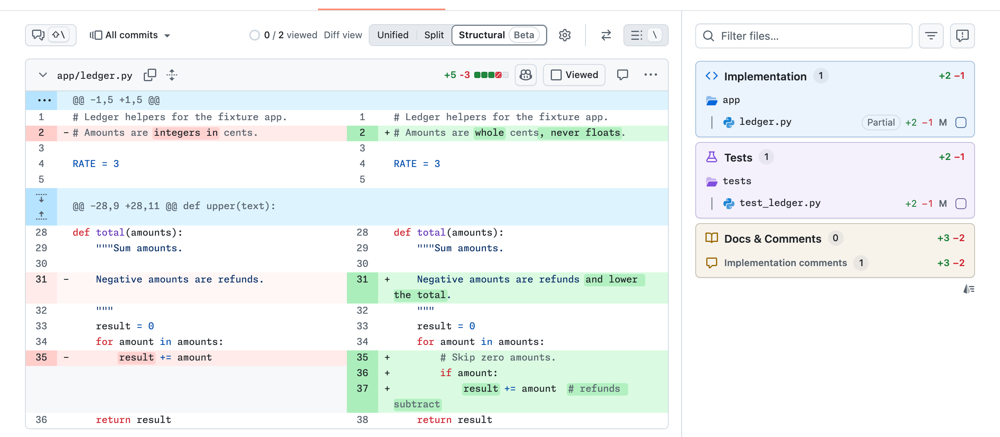

# What's a structural diff?

*Audience: people reviewing pull requests with gh-prism who want to know what Structural
mode does.*

A structural diff compares code, not lines of text. gh-prism's Structural mode shows you
which parts of a line changed and quiets changes that only reformat code, so you see the
edit itself rather than every line it touched.

## Lines versus code

GitHub's diff is a line diff. It marks every line that differs between the old and new
file, whether you changed one word, re-indented a block, or re-wrapped a comment. A
one-word fix inside a reformatted function looks like a rewrite of the whole function.

A structural diff parses both versions of the file into syntax trees, the structure a
compiler or editor sees, and compares the code inside them. So it can tell a real change
from one that only moves whitespace around. It can also point at the tokens that changed,
the names, words, and symbols the code is made of, instead of the whole line.

The idea isn't new. [difftastic](https://github.com/Wilfred/difftastic) and similar tools
do this in the terminal, and they inspired Structural mode.

## How gh-prism does it

gh-prism parses the old and new file with [tree-sitter](https://tree-sitter.github.io/), a
parser library with grammars for many languages. The parsing runs in your browser, from
grammars packaged with the extension. gh-prism then compares the two files token by token
and draws the result onto GitHub's own diff:

- Structural uses GitHub's Split layout, with the old file on the left and the new one on
  the right.
- It highlights the tokens that changed within a line, on a lighter line colour. A line
  that changed in full keeps GitHub's line colour at full strength, with no highlight.
- A line whose change only reformats it also takes the lighter line colour, so you can
  skim past it.
- In comments, strings, and prose files such as Markdown, it highlights the words that
  changed, so a re-wrapped paragraph doesn't light up.

Pick Structural from the **Diff view** control beside GitHub's diff settings gear, on a
pull request's Files changed tab or a commit's page. Pick Unified or Split there to go
back. Structural covers more than twenty languages, including TypeScript, Python, Go, and
Rust; the [README's Structural diffs section](../README.md#structural-diffs-beta) keeps
the full list. It leaves files in other languages as GitHub draws them.

<picture>
  <source media="(prefers-color-scheme: dark)" srcset="images/structural-dark.png">
  
</picture>

## See it on real pull requests

gh-prism's sandbox repository holds public demo pull requests built to show the
difference. Install gh-prism first: without it, GitHub shows them as ordinary line diffs.

- [The sandbox showcase](https://github.com/macintacos/gh-prism-sandbox/pull/13) is the
  first of five pull requests, each built on the one before. Each description lists all
  five and says, file by file, what GitHub's Split shows and what Structural shows
  instead.
- [Larger, realistic changes](https://github.com/macintacos/gh-prism-sandbox/pull/18) show
  Structural on the kind of pull request you review day to day.

## It's in beta

Structural mode is in beta, so it may have bugs. If a highlight looks wrong,
[open an issue](https://github.com/macintacos/gh-prism-extension/issues). If a file's
language isn't covered, a **Request this language** link above its diff opens an issue
asking for it.
