# Documentation Rules

*Audience: coding agents and contributors changing gh-prism's documentation.*

[`AGENTS.md`](../../AGENTS.md) routes a code change to the rule file that governs it. This
file is the same router for docs: it maps every doc gh-prism ships and decides which ones
a change updates. This map is the digraph below plus the doc landscape under it. Read the
digraph as a checklist: edit every doc whose edge matches your change. Each landscape
entry links a pointer under [`references/`](references/) that says how to edit that doc.

## Routing

```graphviz
digraph gh_prism_docs_router {
    node [shape=box];

    "Changing documentation" [shape=doublecircle];
    "Which doc does the change affect?" [shape=diamond];

    "Changing documentation" -> "Which doc does the change affect?";
    "Which doc does the change affect?" -> "Edit README.md" [label="the user-facing front door: what gh-prism does, install, permissions, troubleshooting"];
    "Which doc does the change affect?" -> "Edit CONTRIBUTING.md" [label="contributor onboarding: setup, everyday tasks, where tests live, links onward"];
    "Which doc does the change affect?" -> "Edit CONTEXT.md" [label="a domain term coined, renamed, or sharpened"];
    "Which doc does the change affect?" -> "Edit AGENTS.md (and its CLAUDE.md shim)" [label="the code-change router: a rule file's edge, how to verify a change"];
    "Which doc does the change affect?" -> "Edit docs/README.md" [label="the router for docs/: which page answers a reader's question"];
    "Which doc does the change affect?" -> "Edit docs/ARCHITECTURE.md" [label="how gh-prism works: page kinds, the visit lifecycle, intent and its cache, section rows, diff order, styling, source layout"];
    "Which doc does the change affect?" -> "Edit docs/DEVELOPMENT.md" [label="developing gh-prism: setup, the dev browser, the task catalog, tests, the benchmark, the sandbox repository, hooks, CI, patched dependencies"];
    "Which doc does the change affect?" -> "Edit .claude/skills/release-gh-prism/SKILL.md" [label="the release skill: computing, confirming, and dispatching a release, the release notes"];
    "Which doc does the change affect?" -> "Edit a docs/agents/*-rules.md rule file" [label="a rule for a code area that AGENTS.md routes to"];
}
```

## The doc landscape

- **`README.md`**: the user-facing front door. It says what gh-prism does, how to install
  it, what it may access, and how to fix common problems. How to edit it:
  [`references/readme.md`](references/readme.md). Its § Permissions lists what gh-prism
  stores, so a new kind of stored data adds a line there;
  [`typescript-rules.md`](typescript-rules.md) § Persisted state says so.
- **`CONTRIBUTING.md`**: the short front door for contributors. It gives setup and
  everyday tasks, then links onward. How to edit it:
  [`references/contributing.md`](references/contributing.md). It changes with
  `docs/DEVELOPMENT.md` when a setup step or everyday task changes.
- **`CONTEXT.md`**: the glossary of terms the code, docs, and issues share. How to edit
  it: [`references/context.md`](references/context.md).
- **`AGENTS.md`**: the code-change router, with one edge per rule file and how to verify a
  change. `CLAUDE.md` only imports it. How to edit them:
  [`references/agents-md.md`](references/agents-md.md). It changes with every rule file
  added, removed, or renamed, and its § Verifying changes changes with `.mise/tasks/` when
  the `preflight`, `test`, or `e2e` task changes.
- **`docs/README.md`**: the router for `docs/`, mapping what a reader wants to the page
  that answers it. How to edit it:
  [`references/docs-readme.md`](references/docs-readme.md).
- **`docs/ARCHITECTURE.md`**: how gh-prism works now, naming the module behind each claim.
  How to edit it: [`references/architecture.md`](references/architecture.md). Its module
  names change with the modules.
- **`docs/DEVELOPMENT.md`**: developing gh-prism past the first run. How to edit it:
  [`references/development.md`](references/development.md). Its task catalog changes with
  `.mise/tasks/`, and its setup changes with `CONTRIBUTING.md`.
- **`.claude/skills/release-gh-prism/SKILL.md`**: the `/release-gh-prism` skill, which
  drives a release from the version to the published GitHub Release. How to edit it:
  [`references/release-skill.md`](references/release-skill.md). It changes with the
  `compute` and `release` commands in `scripts/tasks/cli.ts` and with
  `.github/workflows/release.yml`.
- **`docs/agents/*-rules.md`**: one rule file per code area, loaded through `AGENTS.md`.
  This file is one of them. How to add or edit one:
  [`references/agent-rules.md`](references/agent-rules.md).
  [`styling-rules.md`](styling-rules.md) changes with the sheets it governs.

## Audience and diagrams

`README.md`, `CONTRIBUTING.md`, `CONTEXT.md`, and every page directly under `docs/` are
human-facing. `AGENTS.md`, `CLAUDE.md`, and everything under `docs/agents/` are
agent-facing. Put a new human-facing doc directly under `docs/`, and a new agent-facing
one under `docs/agents/`. State a new doc's audience on line 3, under its H1, as
`*Audience: …*`.

Diagrams follow the same split on purpose. Human-facing docs use mermaid, which GitHub
renders inline. Agent-facing docs use graphviz in a `graphviz` fence, which agents read as
text. Don't convert one to the other.

## Keeping the docs true

- **A code change that makes a rule or doc wrong fixes it in the same commit.** That
  covers a rule, a module name in `docs/ARCHITECTURE.md`, and a task in
  `docs/DEVELOPMENT.md`. A doc fixed later is wrong in between.
- **A lesson learned about this repo goes into the rule file for its area in the same
  change**, or into a new rule file per
  [`references/agent-rules.md`](references/agent-rules.md). Never put it in per-user agent
  memory, the notes an agent keeps for one person outside the repo, because no other agent
  or contributor reads that.
- **Per-user memory holds only what is about one person's environment**: their shell,
  paths, editor, or sign-in.

## The maintenance rule

A doc missing from this map is a doc nobody finds. Adding, removing, or renaming a doc
updates, in the same change:

1. This map: the digraph and the doc's landscape entry. A rule file is already covered by
   the shared rule-file node and entry.
2. Its `AGENTS.md` edge, if it is a rule file.
3. Its pointer under [`references/`](references/): add, rename, or remove it. Rule files
   share [`references/agent-rules.md`](references/agent-rules.md) instead of getting their
   own.
4. Every doc that links to it: `docs/README.md` for a page under `docs/`, and
   `CONTRIBUTING.md` § Going deeper when it is listed there.
